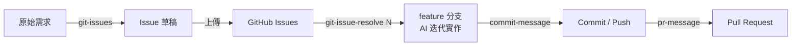

# AI-SDLC

展示 **AI-SDLC（AI 驅動的軟體開發生命週期）** 的示範 repo。

> 我們不是為了技術而導入 AI，是為了管理。
> 讓「照著流程走」，就等於「照著規範做」。

## 為什麼需要 AI-SDLC

AI 程式助理普及後，開發變快了，管理卻變難了：

- 每個人都在聊天視窗裡跟 AI 交談，同一件事兩個人做出兩種樣子
- 需求、實作、測試、交付各做各的，做完不知道有沒有漏
- 規範寫在文件裡，卻沒有人能保證大家照著做
- 每來一位新成員、外包或實習生，就要重新教一次、持續盯一次

問題不在 AI 不夠聰明，而在**每個人用 AI 的方式都不一樣**。AI 不知道你的專案規範、看不到專案現況，也不知道什麼叫做「完成」。

## 做法：把規範內建在流程裡

AI-SDLC 沿用團隊熟悉的 SDLC 階段與 GitHub 工作方式，在每個階段放上一個 AI 任務，並把該階段的開發方法寫進任務裡：

| 階段 | AI 負責 | 內建的方法 | 誰負責確認 |
|------|--------|----------|-----------|
| 需求 / 設計 | 把口語需求轉成產品需求文件，再拆成 Issue、Label、Milestone | SDD（規格驅動開發）、EARS 需求句型 | 全體人員一起審查需求與 Issue，確認後才上傳 |
| 實作 | 依 Issue 實作，迭代到測試全部通過 | TDD（測試驅動開發） | 測試全部通過才算完成 |
| 測試 | 依 API 契約產生 API 測試 | API Test First | 整合測試由資淺工程師親自執行 |
| 交付 | 產生 commit 與 PR，連結 Issue | Conventional Commits、PR 範本 | 搭配 CI/CD 自動測試，資深工程師最後驗收 |

參與者照著流程走，產出就自然符合規範。人的角色從「教育與監督」，變成「在固定的點上確認」。



## AI-SDLC 工具：Hook Runner

整個流程由一支通用的 **Hook Runner**（Bash 腳本）驅動。Runner 是穩定的「prompt 編譯器」，每個 **Hook** 是可替換的任務。一次 AI 執行由五個元件組成：

| 元件 | 作用 |
|------|------|
| agent | 用哪個 AI agent 執行任務 |
| model | 用哪個模型（任務簡單用快的、複雜用強的） |
| steering | 專案規範，每次執行都注入 |
| prompt | 這次要做的任務與完成條件 |
| context | 由程式收集的專案現況（git 狀態、Issue 內容、API 契約…） |

目前的 Hook 覆蓋整個 SDLC：

| 階段 | Hook | 用途 |
|------|------|------|
| 需求 | `git-issues` | 需求 → EARS → Issue 草稿 |
| 實作 | `git-issue-resolve` | 依 Issue 迭代實作，直到完成條件成立 |
| 提交 | `commit-message` | 分析變更，產生 Conventional Commits 訊息 |
| 整合 | `pr-message` | 依範本產生 PR 描述 |

設計原則：

1. **Runner 是 prompt 編譯器**：可用 `--dry-run` 在不呼叫 AI 的情況下檢查與測試
2. **約定優於設定**：檔案存在即註冊，新增任務不用改 Runner
3. **介面要窄**：環境變數進、stdout 出，Runner 不懂 Hook 的參數
4. **事實來源明確**：規範屬於專案、現況由程式收集、契約先於實作
5. **指令在前、資料在後**，資料要標示清楚
6. **AI 準備，人確認**：push、deploy 這類不可逆動作留給人

> 工具集 `ai-dev-tools/` 是獨立的本地 repo，不在這裡公開。這裡公開的是操作步驟、專案規範與文件，以及 AI 產出的成果（Issue、commit、PR、程式碼）。目標是讓你看懂流程、看到產出。

## 前置條件

以下以 macOS 為例（需要 bash）。

| 工具 | 用途 | 確認指令 |
|------|------|----------|
| git | 版本控制 | `git --version` |
| GitHub CLI（`gh`） | 建立 Issue / PR、同步 label 與 milestone | `gh auth status` |
| Python 3.13 | 後端虛擬環境；Runner 用 `python3` 解析 Hook 設定 | `python3 --version` |
| [uv](https://docs.astral.sh/uv/) | 建立後端虛擬環境、安裝 Python 套件 | `uv --version` |
| Node.js 18 以上（建議 LTS）與 npm | 前端（React 18 + Vite 5 + Axios）的建置、開發伺服器與測試 | `node --version`、`npm --version` |
| Kiro CLI（`kiro-cli`） | 實際執行 AI 任務 | `kiro-cli --version` |
| `ai-dev-tools/` | AI-SDLC 工具集（Runner、Hook、API-First 工具鏈），私有，需向維護者取得 | `ls ai-dev-tools` |

另外需要：

- 對本 repo 有讀寫權限的 GitHub 帳號（Hook 會用 `gh` 操作 Issue 與 PR）。
- Kiro 帳號，可以登入 `kiro-cli`。

```bash
# macOS
brew install git gh uv python@3.13 node
```

## 安裝設定

### 1. 取得 repo

```bash
git clone https://github.com/uniheart-tw/ai-sdlc.git
cd ai-sdlc
```

### 2. 放入工具集 `ai-dev-tools/`

工具集是獨立的本地 repo，**不隨本 repo 發布**，已被 `.gitignore` 排除。向維護者取得後，clone 或放到 repo 根目錄，**目錄名稱必須是 `ai-dev-tools`**（Runner 會用到這個名稱）。

```bash
git check-ignore -v ai-dev-tools    # 應顯示被 .gitignore 排除
git status --short                  # 不應出現 ai-dev-tools/
```

### 3. 後端環境（Python）

虛擬環境建在 repo 根目錄（`.venv`），工具集也會使用它。

```bash
uv venv --python 3.13
source .venv/bin/activate
uv pip install -r requirements.txt
uv pip install -r ai-dev-tools/scripts/flask/requirements.txt    # 測試生成工具（flask-he）所需套件，同一個 .venv
```

Python 3.13 就能跑整個流程，包含測試生成工具，不需要 3.14。

### 4. 前端環境（Node.js）

前端放在 `frontend/`（React 18 + Vite 5 + Axios，測試用 Vitest + React Testing Library），**由 AI 依 Issue 實作時才會建立**，所以剛 clone 下來還沒有這個目錄。先確認 Node.js 與 npm 可用：

```bash
node --version           # 18 以上
npm --version
```

`frontend/` 出現之後（例如跑完前端相關的 Issue），安裝相依套件：

```bash
cd frontend
npm install              # package-lock.json 要一併提交
npm run dev              # 開發伺服器 :5173，/api 由 Vite proxy 轉到後端 :5001（以 package.json 的 scripts 為準）
npm run test:run         # 單次執行前端測試（npm test 是 watch 模式）
```

後端開發伺服器跑在 `:5001`，前端的 `/api` 請求靠它回應，所以開發前端時兩邊都要啟動。

### 5. 專案規範（steering）

Issue / PR 的格式範本屬於工具，Hook 直接讀 `ai-dev-tools/scripts/hooks/template/`，**專案不需要複製**。

專案只需要提供**自己的規範**。`git-issue-resolve` 會把 `.kiro/steering/api-first-workflow.md` 注入 AI 的 prompt，這份規範其實就是 `docs/api/API_FIRST_WORKFLOW.md`，用 symlink 指過去，避免兩份內容不同步：

```bash
mkdir -p .kiro/steering
ln -s ../../docs/api/API_FIRST_WORKFLOW.md .kiro/steering/api-first-workflow.md
```

`agent.md`（專案背景與規則）已在 repo 內，Hook 會先要求 AI 讀它。

### 6. 登入 GitHub 與 Kiro

```bash
gh auth login
kiro-cli login
kiro-cli whoami          # 能印出登入資訊即可
```

若出現 `kiro-cli: command not found`，通常是 `~/.local/bin` 不在 PATH。把它加進 shell 設定後，**開新的終端機**再試：

```bash
export PATH="$HOME/.local/bin:$PATH"
```

### 7. 設定 Hook 指令（建議）

```bash
alias hook='bash ai-dev-tools/scripts/hooks/kiro-hook-run.sh'
```

只在 repo 根目錄使用。要常駐的話，寫進 `~/.zshrc` 或 `~/.bash_profile`。

### 8. 驗證安裝

```bash
hook --list                                              # 應列出 git-issues、git-issue-resolve、commit-message、pr-message 等 Hook
hook commit-message --dry-run | head -20                 # 只組 prompt 並印出，不呼叫 AI、不動 git
python ai-dev-tools/scripts/apispec/lint-endpoints.py    # 應顯示「全部符合範本規範」
ls -l .kiro/steering/                                    # 應看到 api-first-workflow.md 指向 docs/api/API_FIRST_WORKFLOW.md
```

`--dry-run` 不會呼叫 AI，也不會有任何 git 操作。用它可以先確認 Runner 抓到的專案現況與規範是否正確。

### 9. 版控管理：展示後回到初始狀態

這個 repo 常常要重複展示。做法是：先把初始狀態固定成基準 tag，每次展示開一條獨立分支，展示完清掉本機與 GitHub 上的殘留。

**(1) 只做一次：把初始狀態固定成基準**

確認目前的內容就是你要的初始狀態後，在 `develop` 分支上用 Hook 提交，**提交完成後**再打 tag：

```bash
git status --short                          # 先確認要提交的內容，不應出現 .env、ai-dev-tools/
hook commit-message                         # 有 git 權限時：add -A → commit → push 一次完成
git log -1 --oneline                        # 確認 HEAD 就是剛才的基準 commit
git tag demo-baseline                       # tag 打在這個 commit 上
git ls-tree -r --name-only demo-baseline    # 確認 tag 內含 agent.md、backend、docs 等基準檔案
git push origin demo-baseline               # 分支已被 Hook 推送，只需要再推 tag
```

- **Hook 不會等你確認**：有 git 權限時，`hook commit-message` 會直接 `git add -A`、commit 並 push 到目前分支，中間沒有確認檔案清單的步驟。所以務必先用 `git status --short` 檢查；`.env`、`ai-dev-tools/`、`temp/` 等已被 `.gitignore` 排除。
- Hook 可能順手更新變更目錄裡的 `README.md` 並一起提交，所以基準內容可能和提交前略有不同，tag 之後用 `git ls-tree` 確認即可。
- **tag 要在 commit 之後才打**。如果本機已經有舊的 `demo-baseline`（例如先前誤打在舊 commit 上），改用 `git tag -f demo-baseline` 移動它；只有在 tag **還沒推到遠端**時才能這樣做。
- 如果 Hook 因權限被拒，會在終端提示改跑 `bash ai-dev-tools/scripts/commit-and-push.sh`；它會列出檔案清單並等你按 `y`。要讓分支和 tag 一起推送的話加 `--no-push`，最後改用 `git push origin develop demo-baseline`。

**(2) 每次展示：開一條獨立的基底分支**

```bash
# 從遠端(origin)把所有 tag 抓到你本機
git fetch --tags
# 要用 demo-baseline 這個 tag 當起點
git checkout -b demo/run-1 demo-baseline
git push -u origin demo/run-1
```

展示過程都以這條分支為基底：

- `hook git-issue-resolve <N>` 會從目前分支的最新 commit 切出 `feature/.../issue-N`，所以要先切到 `demo/run-1`。
- 開 PR 時指定它當 base：`hook pr-message demo/run-1`，把 PR 合併進 `demo/run-1`，**不要合進 `develop`**。

`develop` 和 `demo-baseline` 因此永遠保持乾淨。展示結束後，`demo/run-1` 與所有 feature 分支都會在 (3) 清掉。

**(3) 展示完：回到初始狀態**

先切回 `develop`。刪除本機的展示分支前一定要先做這一步，因為 Git 不能刪除目前所在的分支：

```bash
git checkout develop
git status --short                    # 被追蹤的檔案應該是乾淨的
```

本機被 `.gitignore` 排除的檔案**不需要清理**：`temp/`、`docs/api/API_REFERENCE.md`、`docs/api/openapi.yaml`，以及 `ai-dev-tools/` 內產生的暫存，都不影響下一輪執行。`git-issues` 開始時會自己清掉上一輪的 `temp/github-issues/` 與 `temp/user_reps_report/`，兩個生成物在重新跑 API-First 工具鏈時會被覆蓋。**請不要刪除 `ai-dev-tools/` 內的任何檔案。**

只有兩件事要留意：

- `temp/user_reps/` 底下的**所有**需求檔都會被 `git-issues` 當成輸入。換展示題材時，只留這一輪要用的需求檔。`temp/` 不進版控，`git checkout` 還原不了它，要重複使用的需求請另存備份。
- 展示中如果上傳過檔案，`backend/uploads/` 內會留有資料，用 `rm -rf backend/uploads/*` 清掉（`.gitkeep` 不受影響）。

接著清掉這一輪在 GitHub 與分支上留下的東西：關閉所有 open Issue，刪除展示分支 `demo/*` 與 `git-issue-resolve` 建立的所有 `feature/*` 分支（本機與遠端）。GitHub 上的清理和本機工作目錄無關，切換分支前後都可以做；唯一的順序限制就是上面說的：本機分支要在切回 `develop` 之後才能刪。

```bash
git fetch --prune                                              # 先同步遠端分支清單

# 1. 關閉所有 open Issue
gh issue list --state open --json number,title --jq '.[] | "#\(.number) \(.title)"'   # 先看清單
gh issue list --state open --json number --jq '.[].number' | xargs -I{} gh issue close {}

# 2. 刪除遠端的展示分支與 feature 分支
git branch -r -v --list 'origin/feature/*' 'origin/demo/*'     # 先看清單，並記下每個分支的 commit
git branch -r --list 'origin/feature/*' 'origin/demo/*' | sed 's|origin/||' | xargs git push origin --delete

# 3. 刪除本機的同名分支
git branch -v --list 'feature/*' 'demo/*'
git branch --list 'feature/*' 'demo/*' | xargs git branch -D

# 4. 確認只剩 develop 與 main
git branch -a
```

- **刪除前先看清單**：第 2、3 步會刪掉清單中的**所有**分支。清單裡有要保留的展示紀錄時，改成逐一刪除（`git push origin --delete <分支>`、`git branch -D <分支>`）。
- **刪錯了可以重建**：分支只是指向 commit 的名稱，commit 本身還在。用清單裡記下的 commit 重建，例如 `git branch demo/run-1 7e5af91 && git push -u origin demo/run-1`。
- 清單為空時，`xargs` 不會執行後面的指令，重複執行也沒有關係。

**(4) 基準更新時：移動 tag**

`develop` 上有新的基準內容（例如新增 `docs/courses/` 的課程文件）時，要把 `demo-baseline` 移到最新的 commit，下一輪從 tag 開出的展示分支才會包含它：

```bash
git checkout develop && git pull
git status --short                          # 工作目錄應該是乾淨的（新內容都已提交並推送）
git tag -f demo-baseline                    # 把本機 tag 移到目前的 HEAD
git ls-tree -r --name-only demo-baseline    # 確認 tag 內含新的基準內容
git push --force origin demo-baseline       # 只強制推送這一個 tag，不影響任何分支
```

- 強制推送要**明確寫出 tag 名稱**，不要用 `git push --force --tags`。
- 其他已經抓過舊 tag 的電腦，要執行 `git fetch --tags --force` 才會更新。
- 一定要在新內容都提交之後才移動 tag；之後再改的內容不會自動進到 tag 裡。

**GitHub 端無法真正重置**

- Issue 編號只會一路往上加，第二輪不會從 `#1` 開始。
- 已建立的 Issue 只能關閉；刪除需要管理員權限（`gh issue delete`）。
- 如果每次展示都需要從 `#1` 開始，改把這個 repo 設成 **template repository**，每次展示用它建立一個新的 repo。代價是展示紀錄會分散在多個 repo。

## 準備原始需求

`hook git-issues` 的輸入是 `temp/user_reps/` 目錄下的需求檔，**跑之前要先把需求寫在這裡**，沒有檔案就沒有東西可以拆。

```bash
mkdir -p temp/user_reps
```

在裡面建立一個 Markdown 檔，例如 `temp/user_reps/001-<主題>.md`。用口語寫即可，不需要寫成規格；寫得越具體，拆出來的 Issue 越準。建議包含：

```markdown
# 使用者需求：<主題>

## 需求概述
一句話描述要做什麼。

## 需求陳述
作為 <角色>，我想要 <功能>，以便 <目的>。

## 具體需求
- 需求點 1
- 需求點 2

## 非功能需求（選填）
- 效能 / 安全性 / 可用性

## 驗收條件
- [ ] 可以測試的條件 1
- [ ] 可以測試的條件 2

## 限制條件
- 技術 / 時間 / 資源上的限制
```

目錄的版控規則：整個 `temp/` 都被 `.gitignore` 排除，都不進版控。

| 路徑 | 說明 | 進版控 |
|------|------|:------:|
| `temp/user_reps/` | 原始需求，流程的輸入 | 否 |
| `temp/user_reps_report/` | `git-issues` 產生的需求規格 | 否 |
| `temp/github-issues/` | `git-issues` 產生的 Issue 草稿 | 否 |

需求檔不進版控，所以換電腦或展示後清掉就會消失。要重複使用的需求，請另存備份（見「9. 版控管理」）。

需求檔涉及的範例資料請用假資料（email 用 `@example.com`），不要放真實個資。

## 常用指令

**跑一輪 AI-SDLC**（每一步的產出都先讓人確認再往下）：

```bash
# 0. 先把需求寫進 temp/user_reps/（見上一節）
hook git-issues                  # temp/user_reps/ → 需求規格與 Issue 草稿
bash ai-dev-tools/gh-issue/scripts/upload-issues.sh --dry-run   # 先看會建立什麼，確認後去掉 --dry-run 正式上傳（缺少的 label / milestone 會一併建立）
hook git-issue-resolve <N>       # 依 Issue 編號實作
hook commit-message              # 產生 commit message，再由人確認後提交
hook pr-message <基底分支>        # 產生 PR 描述並建立 PR；展示時基底分支用 demo/run-N（見「9. 版控管理」）
```

**API-First 工具鏈**（在 repo 根目錄、啟用 `.venv` 後執行，第一步一律先 lint）：

```bash
T=ai-dev-tools/scripts/apispec
python $T/lint-endpoints.py      # 檢查手寫端點文件是否符合範本
python $T/build-reference.py     # 合併 → docs/api/API_REFERENCE.md
python $T/md-to-openapi.py       # 產生 → docs/api/openapi.yaml
python $T/validate-openapi.py    # 驗證規範
```

API-First 工具鏈的完整說明見 [API-First 開發流程](./docs/api/API_FIRST_WORKFLOW.md)。

## 專案結構

```
ai-sdlc/
├── docs/
│   ├── courses/            課程詳細內容（講稿、預備知識等）
│   └── api/                API-First 文件
│       └── endpoint/       手寫端點文件與 metadata.yaml（API 名稱、版本、伺服器、認證方式）
├── backend/                示範用 Flask 專案
├── frontend/               前端（React 18 + Vite 5 + Axios），由 AI 依 Issue 實作時建立
├── temp/user_reps/         原始需求（git-issues 的輸入），需自行建立；整個 temp/ 不進版控
├── .kiro/steering/         專案規範，symlink 到 API-First 流程文件（見「安裝設定」第 5 步）
├── agent.md                專案背景與規則（Hook 執行前 AI 會先讀）
├── requirements.txt        Python 套件（裝在根目錄的 .venv）
└── ai-dev-tools/           工具集（本地獨立 repo，.gitignore 排除，不在版控內）
```

示範專案只是承載流程的題材，內容可以替換，不是本 repo 的重點。

## 從哪裡開始看

| 想了解 | 看這份 |
|--------|--------|
| 課程的詳細內容 | [docs/courses/AI-SDLC-實戰課程.md](./docs/courses/AI-SDLC-實戰課程.md) |
| 要準備什麼、怎麼安裝 | 本文「前置條件」「安裝設定」 |
| 怎麼跑完一輪 AI-SDLC | 本文「準備原始需求」「常用指令」 |
| 展示完怎麼回到初始狀態 | 本文「安裝設定」第 9 步「版控管理」 |
| API-First 開發流程與工具鏈 | [docs/api/API_FIRST_WORKFLOW.md](./docs/api/API_FIRST_WORKFLOW.md) |
| API 端點文件怎麼寫 | [docs/api/API_REFERENCE_TEMPLATE.md](./docs/api/API_REFERENCE_TEMPLATE.md)、[docs/api/RESPONSE_CONVENTIONS.md](./docs/api/RESPONSE_CONVENTIONS.md) |
| 專案背景與規則（給 AI 讀） | [agent.md](./agent.md) |
