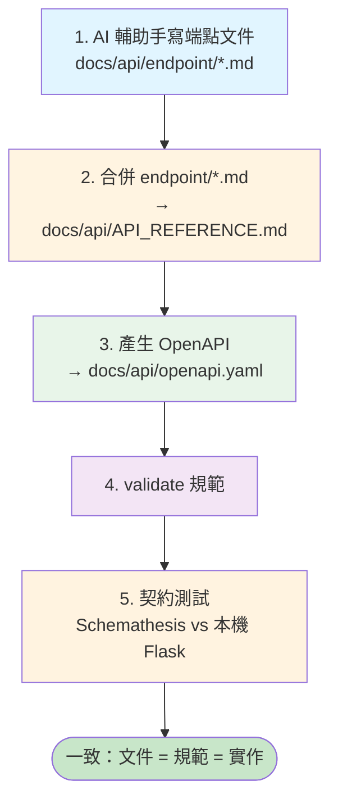

# API-First 開發工作流程（Flask 地端）

本文件說明 ai-sdlc 採用的 **API-First** 開發流程。本專案後端為 **Flask 3（app factory + Blueprint）** 的地端服務，
API 的事實來源是 `backend/routes/*.py` 的實際行為。本文件只談流程；端點該怎麼寫、回應該長什麼樣，分別見範本與回應型態規範（下方連結），不在此複述。

## 什麼是 API-First（本專案版）

先以文件定義 API 契約，再據以生成 OpenAPI 規範並做契約測試，確保「文件、規範、實作」三者一致。

契約以 **AI 輔助手寫**的 Markdown 為來源，單一端點一個檔，置於 `docs/api/endpoint/*.md`。
之後由工具鏈合併、轉成 OpenAPI 規範、驗證，最後以契約測試確認實作符合規範。

```
AI 輔助手寫 docs/api/endpoint/*.md
      │  合併工具（ai-dev-tools/scripts/apispec/）
      ▼
docs/api/API_REFERENCE.md（合併生成物，勿手動編輯）
      │  md→openapi 工具
      ▼
docs/api/openapi.yaml（OpenAPI 規範，生成物）
      │  validate 工具
      ▼
（驗證通過）
      │  契約測試（Schemathesis，打本機 Flask）
      ▼
確認實作符合規範
```



### 關鍵原則

- **單一真實來源**：端點契約手寫於 `docs/api/endpoint/*.md`，由合併工具產生 `docs/api/API_REFERENCE.md`。
  你只維護 `docs/api/endpoint/` 下的端點檔，**不要直接編輯 `docs/api/API_REFERENCE.md` 或 `docs/api/openapi.yaml`**（皆為生成物）。
- **文件對齊程式**：route 檔（`backend/routes/*.py`）是 API 行為的事實來源；文件描述現況，不是反過來。
- **契約測試把關**：用 Schemathesis 對本機 Flask 跑契約測試，驗證實際回應符合 OpenAPI 規範。

---

## 文件來源結構

API 契約採**單一端點一檔 ＋ 合併生成**。手寫來源集中在 `docs/api/endpoint/`，基礎文件與生成物置於 `docs/api/`：

```
docs/api/README.md                 ← 全域資訊（目錄導覽 / 分檔規則 / 撰寫規範；非合併來源）
docs/api/API_REFERENCE_TEMPLATE.md ← 單一端點撰寫範本
docs/api/RESPONSE_CONVENTIONS.md   ← 回應型態規範基準
docs/api/API_FIRST_WORKFLOW.md     ← 本文件（開發流程）
docs/api/endpoint/*.md             ← 各端點文件（AI 輔助手寫來源，一端點一檔；合併的唯一來源）
        │
        │  合併工具 ai-dev-tools/scripts/apispec/build-reference.py
        │  （只收 endpoint/*.md，檔首自動產生「端點總覽」彙整表）
        ▼
docs/api/API_REFERENCE.md          ← 合併生成物，勿手動編輯
        │
        │  md→openapi 工具
        ▼
docs/api/openapi.yaml              ← OpenAPI 規範，生成物
```

合併由 `ai-dev-tools/scripts/apispec/build-reference.py` 負責：來源只收 `endpoint/*.md`，依來源檔相對路徑字典序串接，並在檔首自動產生「端點總覽」彙整表（欄位：端點 / 方法 / Tag / Handler，Handler ＝ Operation ID）；撰寫者不需手動維護順序或彙整表。

> 新增 / 修改端點時，編輯對應的 `docs/api/endpoint/<endpoint>.md`。
> API 名稱、版本、伺服器位址與認證方式（`securitySchemes`）寫在 `docs/api/endpoint/metadata.yaml`，合併時由 `build-reference.py` 寫入 `API_REFERENCE.md` 檔首，再由 `md-to-openapi.py` 取用。
> 各端點是否需要認證，由該端點 `### Request` 的 Headers 決定（有 `Authorization: Bearer ...` 即需認證，否則視為公開），規則見 [API_REFERENCE_TEMPLATE.md](./API_REFERENCE_TEMPLATE.md)。
> 全域資訊（目錄導覽、分檔規則、端點撰寫規範）維護在 `docs/api/README.md`（非合併來源）。
> 每個端點的 Request / Response Model 定義在該端點自己的檔內，不集中共用。改完後重新執行合併與產生規範。

---

## 工具鏈

工具落點 `ai-dev-tools/scripts/apispec/`（詳見其 [README](../../ai-dev-tools/scripts/apispec/README.md)）。
所有路徑皆相對於目前工作目錄，請在 **repo 根目錄**執行並先啟用 venv。
契約測試用 **Schemathesis**（已列入 根目錄的 `requirements.txt`）。

| 步驟 | 工具 | 輸入 → 輸出 |
|------|------|-------------|
| 0. 檢查 | `ai-dev-tools/scripts/apispec/lint-endpoints.py` | `docs/api/endpoint/*.md` vs `API_REFERENCE_TEMPLATE.md` 規範 |
| 1. 合併 | `ai-dev-tools/scripts/apispec/build-reference.py` | `docs/api/endpoint/*.md` → `docs/api/API_REFERENCE.md`（檔首含端點總覽彙整表） |
| 2. 產生 OpenAPI | `ai-dev-tools/scripts/apispec/md-to-openapi.py` | `docs/api/API_REFERENCE.md` → `docs/api/openapi.yaml` |
| 3. 驗證 | `ai-dev-tools/scripts/apispec/validate-openapi.py` | 依 `openapi-validator-rules.yaml` 檢查 `docs/api/openapi.yaml` |
| 4. 契約測試 | `schemathesis`（CLI） | `docs/api/openapi.yaml` vs 本機 Flask |

> 三支工具皆不帶參數即使用預設路徑（`docs/api/...`），且都支援 `--help`。

---

## 開發步驟

### 階段 1：撰寫 / 更新端點文件

**輸入**：需求、現有 route 行為。
**輸出**：`docs/api/endpoint/<endpoint>.md`。

1. 確定要新增 / 修改哪些端點，對照 `backend/routes/*.py` 的實際行為。
2. 以 [API_REFERENCE_TEMPLATE.md](./API_REFERENCE_TEMPLATE.md) 的單一端點範本撰寫。
3. 回應型態一律遵循 [RESPONSE_CONVENTIONS.md](./RESPONSE_CONVENTIONS.md) 的分類。
4. 每個端點自行定義 Request / Response Model，以 API 實際回傳形狀為準；此 API 規格與資料庫 schema 彼此獨立，勿以 DB schema 作為 model 的事實來源。

### 階段 2：合併並產生 OpenAPI 規範

**輸入**：`docs/api/endpoint/*.md`。
**輸出**：`docs/api/API_REFERENCE.md`（合併生成物）、`docs/api/openapi.yaml`（OpenAPI 規範）。

```bash
# 於 repo 根目錄啟用 venv 後執行
source .venv/bin/activate
T=ai-dev-tools/scripts/apispec

# 0. 檢查端點文件是否遵守範本（有錯誤先修再往下）
python $T/lint-endpoints.py

# 1. 合併 endpoint/*.md（檔首含端點總覽彙整表）→ docs/api/API_REFERENCE.md
python $T/build-reference.py

# 2. 產生 OpenAPI 規範 docs/api/openapi.yaml
python $T/md-to-openapi.py

# 3. 驗證規範（依 openapi-validator-rules.yaml）
python $T/validate-openapi.py
```

> `docs/api/API_REFERENCE.md` 與 `docs/api/openapi.yaml` 皆為生成物，直接手動編輯會在下次合併 / 產生時被覆蓋。

### 階段 3：契約測試（Schemathesis，打本機 Flask）

啟動本機 Flask 伺服器後，用 Schemathesis 以 OpenAPI 規範對它執行契約測試：

```bash
# 1. 啟動本機 Flask（埠號依本機 .env / 設定為準）
cd backend
python app.py

# 2. 另開一個終端機跑契約測試（URL 指向本機 Flask 實際埠號）
schemathesis run docs/api/openapi.yaml --url http://localhost:<port>
```

**GET 冒煙測試（可直接複製重現）**：先只對讀取類端點跑，避免改動開發資料。於 repo 根執行：

```bash
# 1. 啟動本機 Flask（開發埠 5001；可用環境變數覆蓋）
cd backend
PORT=5001 python app.py

# 2. 另開終端機，用 venv 內的 schemathesis，只測 GET 端點
.venv/bin/schemathesis run docs/api/openapi.yaml \
  --url http://localhost:5001 \
  --include-method GET
```

> `--include-method GET` 僅挑選讀取類端點（規範中的 GET operation），不會觸發會改資料的 `POST` / `PUT` / `DELETE`。
> 測試過程 Hypothesis 會在 `backend/.hypothesis/` 產生快取（已列入 `.gitignore`）；測後請停掉 Flask、釋放埠。

**縮小測試範圍（針對特定 tag / API / operation / 階段）**：修改或除錯單一區塊時，不必每次全跑。Schemathesis 以 `--include-TYPE` / `--exclude-TYPE` 過濾（`TYPE` 可為 `tag` / `path` / `method` / `operation-id` / `name`），並以 `--phases` 選測試階段：

```bash
# 只測某個 tag（資源群組），例如只驗 videos
.venv/bin/schemathesis run docs/api/openapi.yaml \
  --url http://localhost:5001 --include-tag videos

# 只測某支 API（依路徑；可再加 --include-method 限定方法）
.venv/bin/schemathesis run docs/api/openapi.yaml \
  --url http://localhost:5001 --include-path /api/videos --include-method GET

# 只測單一端點（依 operationId，即文件的 Operation ID＝Flask blueprint.view_func）
.venv/bin/schemathesis run docs/api/openapi.yaml \
  --url http://localhost:5001 --include-operation-id videos.list_videos

# 排除會改資料或非 JSON 的端點（例如排除某 tag）
.venv/bin/schemathesis run docs/api/openapi.yaml \
  --url http://localhost:5001 --include-method GET --exclude-tag reports

# 只跑最快的 examples 階段（規範內嵌範例），略過耗時的 coverage / fuzzing / stateful
.venv/bin/schemathesis run docs/api/openapi.yaml \
  --url http://localhost:5001 --include-tag videos --phases examples
```

> `--include-TYPE-regex` / `--exclude-TYPE-regex` 支援正則比對（例如 `--include-path-regex '^/api/videos'`）。
> `--phases` 可選 `examples,coverage,fuzzing,stateful`（逗號分隔）；只想快速確認某端點時用 `--phases examples` 最快。
> `--exclude-checks`（如 `not_a_server_error`）可在除錯時暫時略過特定檢查。

**Schemathesis 會驗證**：

| 檢查項目 | 說明 |
|----------|------|
| Status Code | 實際回應的狀態碼是否在規範定義範圍內 |
| Response Schema | 回應 body 的 JSON 結構是否符合規範 schema |
| Content-Type | 回應的 Content-Type 是否正確 |

**注意事項**：

- 建議先對讀取類（`GET`）端點跑契約測試；會改動資料的端點（`POST` / `PUT` / `DELETE`）請用可重置的開發資料庫。
- 若有端點需要身分驗證，依後端當前的驗證方式帶入對應憑證再測（驗證方式見後端實作，不在本文件固定）。
- 回傳非 JSON 的端點（串流、檔案下載、純文字等）宜只驗 status / headers、排除 body schema 驗證；回應型態細節見 [RESPONSE_CONVENTIONS.md](./RESPONSE_CONVENTIONS.md)。

---

## 既有後端測試（不受本流程影響）

後端既有單元 / 整合測試仍以 pytest 執行（本流程不改程式，跑此僅確認未破壞）：

```bash
cd backend && python -m pytest -q
```

契約測試（Schemathesis）與既有 pytest 測試互補：前者驗「實作 vs OpenAPI 規範」，後者驗「程式內部邏輯」。

---

## 常見問題

### Q：為什麼不直接編輯 `docs/api/API_REFERENCE.md`？

A：它是由 `docs/api/endpoint/*.md` 合併而成的生成物，手動編輯會在下次合併時被覆蓋。要改內容，改對應的 `docs/api/endpoint/<endpoint>.md`。

### Q：需要身分驗證的端點怎麼測？

A：依後端當前的驗證方式帶入對應憑證再對本機 Flask 執行；驗證方式以後端實作為準，不在本文件固定。

### Q：回傳非 JSON 的端點怎麼測？

A：串流、檔案下載、純文字等端點回傳非 JSON，契約測試宜只驗 status 與 headers，不驗 body schema。

### Q：如何新增一個 API 端點的文件？

A：
1. 在 `docs/api/endpoint/<endpoint>.md` 以範本撰寫端點（參考 [API_REFERENCE_TEMPLATE.md](./API_REFERENCE_TEMPLATE.md)）。
2. 執行合併與產生規範（階段 2）。
3. 啟動本機 Flask 後跑 Schemathesis 契約測試（階段 3）。

---

## 相關文件

- [API 端點文件範本](./API_REFERENCE_TEMPLATE.md) — 單一端點的撰寫範本
- [回應型態規範（RESPONSE_CONVENTIONS）](./RESPONSE_CONVENTIONS.md) — 本專案所有 spec 回應形狀的規範基準
- [API 端點文件目錄](./README.md) — 手寫端點文件來源索引與端點撰寫規範
- [架構說明](../ARCHITECTURE.md) — 後端分層與測試說明
- [工具腳本說明](../../backend/scripts/README.md) — 既有腳本慣例
