# AI-SDLC
## AI 驅動的軟體開發生命週期（Python Flask 篇）

> 我們不是為了技術而導入 AI，是為了管理。

完整內容：[AI-SDLC-實戰課程.md](./AI-SDLC-實戰課程.md)

---

## 課程主線：七個步驟

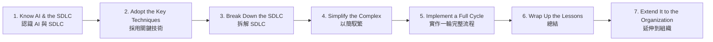

| 步驟 | 要回答的問題 |
|------|------------|
| 1. Know AI & the SDLC | AI 能做到什麼？用 AI 開發難在哪？ |
| 2. Adopt the Key Techniques | 怎麼進行、定義需求、確保品質與一致、生成測試？ |
| 3. Break Down the SDLC | 每個階段要交給 AI 哪些材料？ |
| 4. Simplify the Complex | 怎麼用一支 runner 貫通所有階段？ |
| 5. Implement a Full Cycle | 一輪完整的實戰 |
| 6. Wrap Up the Lessons | 人機邊界、設計原則 |
| 7. Extend It to the Organization | 導入的投資、員工與組織 |

貫穿全場的三個問題：**介面是什麼？誰是事實來源？人在哪裡把關？**

---

<!-- 第 1 部分 -->

**Step 1 / 7 · Know AI & the SDLC**

# 1. 開場
## 為什麼要 AI-SDLC

---

## 人類對 AI 的期望：OpenAI 的五個等級

| 等級 | 名稱 | 能做到什麼 |
|:---:|------|-----------|
| 1 | 聊天機器人 | 用自然語言對話 |
| 2 | 推理者 | 解決基本問題 |
| 3 | 代理人 | 代表使用者執行任務 |
| 4 | 創新者 | 協助發明與創新 |
| 5 | 組織 | 不需人介入，完成整個組織的工作 |

- 寫程式已進入第 3 級：AI 能讀檔、改程式、跑測試、commit
- 第 5 級「完全交給 AI」不切實際：能力再強，組織也不會把管理完全授權給沒有監督的對象，對人對 AI 都一樣
- AI-SDLC 的詮釋：組織等級的 AI 是**把 AI 融入組織活動**，AI 負責產出，人負責定義、審查與判斷
- **所以問題變成管理問題：怎麼讓 AI 照規範做事，人在哪裡把關**

<small>出處：Bloomberg（2024-07-11）。這是 OpenAI 內部分類，不是業界標準。</small>

---

## 問題：每個人都用自己的方式跟 AI 開發

| 現象 | 管理上的後果 |
|------|------------|
| 交談式開發 | 同一件事，兩個人做出兩種樣子 |
| 零散 | 需求和程式對不起來 |
| 沒有規範 | 只能靠 code review 事後抓 |
| 參與者流動 | 每來一個人就要重新教、持續盯 |

> 問題不在 AI 不夠聰明，而在**每個人用 AI 的方式都不一樣**。
> 傳統解法是教育與監督：寫規範、辦訓練、code review、專人監督。成本高、事後才發現、規模大就管不動。

---

## 我們的解法：把規範內建在流程裡

| 以前靠人 | 現在靠流程 |
|---------|-----------|
| 教大家寫需求 | AI 照 PRD、EARS、Issue 範本產生 |
| 提醒先寫測試 | 測試沒過就不算完成 |
| 盯 commit 格式 | 一律產生 Conventional Commits，順便更新 README |
| 檢查 PR 有沒有連 Issue | 從分支名稱自動寫上 `Closes #N` |

> 目標是**專案的一致性**：人從「教育與監督」轉為「在固定的點上確認」。

---

## 要補上 AI 的三個盲點

| AI 不擅長 | 流程要提供的 |
|----------|------------|
| 知道專案沒寫下來的潛規則 | **規範**：範本、開發方法、專案背景 |
| 自己找現在的 diff、Issue、路由表 | **現況**：每次自動收集的上下文 |
| 判斷什麼時候算完成 | **完成條件**：可以自動驗證的測試 |

---

<!-- 第 2 部分 -->

**Step 2 / 7 · Adopt the Key Techniques**

# 2. 預備觀念
## 專案開發的五個基本問題

| 問題 | 本課程的答案 |
|------|------------|
| 專案要怎麼進行？ | AI-SDLC |
| 需求要怎麼定義？ | SDD |
| 怎麼確保品質？ | 測試金字塔 |
| 怎麼確保文件、程式、測試一致？ | API Test First |
| 測試內容怎麼生成？ | Harness Engineering |

---

## 專案怎麼進行：傳統 SDLC 與 AWS AI-DLC

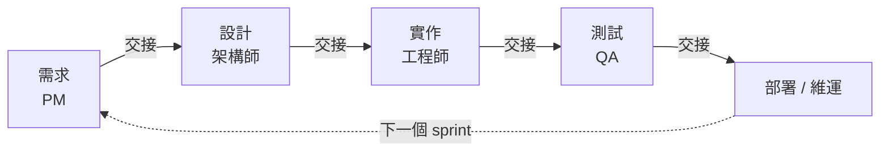

AI 只是輔助工具，流程本身沒有改變，交接仍由人負責。

**對照組 AWS AI-DLC：以開發速度為目標，重新設計生命週期**（3 階段 9 步驟）

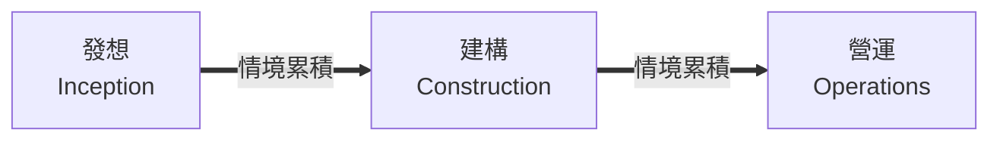

- 每個活動都是：AI 擬計畫 → AI 提問 → **人確認** → AI 執行
- 重新定義儀式：Sprint → **Bolt**（以小時或天計）、Epic → **Unit of Work**
- 團隊以 Mob Elaboration / Mob Construction 一起確認 AI 的提案

---

## 我們的 AI-SDLC：沿用 SDLC，把方法內建進每個階段

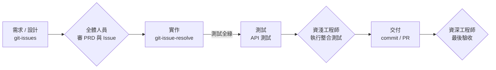

---

## 每個階段：誰把關、內建什麼方法

| 階段 | 誰確認 | 內建的方法 | 參與者不用再被教的事 |
|------|-------|-----------|------------------|
| 需求 / 設計 | **全體人員** | SDD：PRD、EARS、Issue 格式 | 需求怎麼寫、Issue 怎麼拆 |
| 實作 | **不需要人** | TDD + Harness | 做到哪裡算完成 |
| 測試 | **資淺工程師**執行最後整合測試 | API Test First | 要測哪些情境、錯誤碼 |
| 交付 | CI/CD + **資深工程師**驗收 | Conventional Commits、PR 範本 | commit / PR 格式、文件更新 |

> 每個階段的產物都存在 repo 或 GitHub，下一個 hook 再把它收集交給 AI，**整條流程串在一起**。

---

## 三者比較

| 面向 | 傳統 SDLC | AWS AI-DLC | AI-SDLC |
|------|----------|-----------|---------|
| 出發點 | — | **開發速度** | **專案管理、一致性** |
| 階段 | 6 階段 | 3 階段 9 步驟 | 沿用 SDLC |
| 開發方法放哪 | 文件與訓練 | Mob 儀式中確認 | **寫進每個 hook** |
| 工作拆分 | Epic / Story | Unit of Work | GitHub Issue |
| 對參與者的要求 | 自律遵守 | 參與 Mob 儀式 | **會用流程即可** |

> AI-DLC 為了速度重新設計流程；AI-SDLC 為了管理，把方法內建在現有流程裡。
> 兩者出發點不同，但都採用「AI 產出、人確認」「情境逐步累積」「產物存進專案」。

---

## 需求怎麼定義：TDD / BDD / SDD

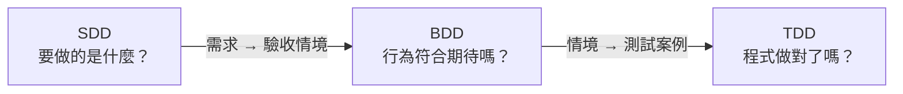

| | TDD | BDD | SDD |
|---|-----|-----|-----|
| 參與者 | 開發者 | 開發、PM、QA | PM、架構師、開發者、AI |
| 規範 | AAA、測試命名 | Gherkin | EARS、PRD、OpenAPI |
| 主要產物 | 測試程式 | `.feature` 情境檔 | 需求、設計、任務文件 |

> 三種都可以，**團隊選自己習慣的**；這裡只是介紹，不比較優劣。

---

## 同一條需求的三種寫法

**SDD（EARS）**
`If 使用者連續輸入錯誤密碼 5 次, then the system shall 鎖定帳號 15 分鐘。`

**BDD（Gherkin）**
```gherkin
Scenario: 連續輸入錯誤密碼後鎖定帳號
  Given 使用者帳號已連續登入失敗 4 次
  When 使用者再次輸入錯誤密碼
  Then 帳號被鎖定 15 分鐘
```

**TDD（AAA）**
```python
def test_login_locks_account_after_five_failures():
    account = Account(failed_attempts=4)          # Arrange
    result = login(account, password="wrong")     # Act
    assert result.locked_minutes == 15            # Assert
```

**我們的選擇：SDD**
- 有人認為 TDD 的寫法對 AI 生成測試比較友善
- 本課程選 SDD，因為 **Kiro 建議的開發方式就是 SDD**（Spec：需求 → 設計 → 任務）

---

## 怎麼確保品質：測試金字塔


| 層級 | 驗證什麼 | 工具（Python） |
|------|---------|---------------|
| E2E / UI | 使用者完整流程 | Playwright |
| 整合 / API | 元件之間、HTTP API | pytest + `test_client`、Schemathesis |
| 單元 | 單一函式的邏輯 | pytest |

> 重點不是固定比例，而是**每一層都要有，並知道它在保護什麼**。

---

## 怎麼確保一致：API Test First

常見的問題：文件、程式、測試各走各的。
**API Test First 是一套開發規範**：以 API 契約為唯一來源，文件、規格、測試都從契約產生，程式必須通過測試。

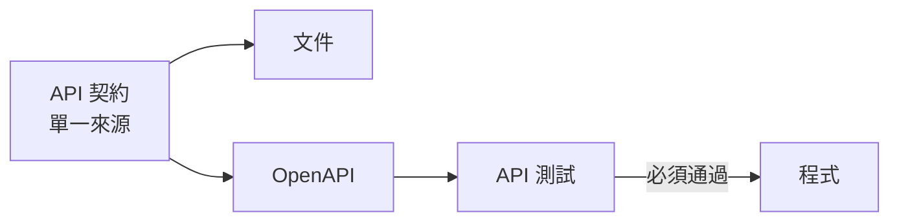

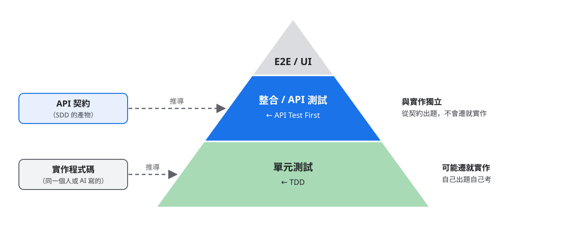

---

## 為什麼要 API Test First

1. **單一來源**：改契約，文件、規格、測試一起更新
2. **契約可以被檢查**：程式和契約不一致，測試直接失敗
3. **最穩定的護欄**：內部怎麼重構，契約不變測試就不用改
4. **人看得懂**：request / response 是人掌握功能的抓手
5. **成本甜蜜點**：比 E2E 快又穩，比單元測試更接近真實行為
6. **前後端可平行開發**

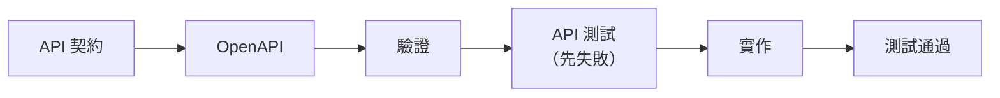

---

## 測試怎麼生成：Harness Engineering

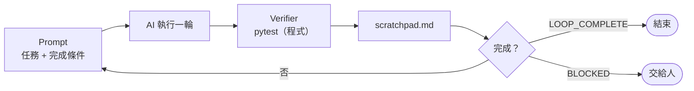

- 測試內容交給 AI 生成，harness 讓它反覆執行、驗證、修正到通過（flask-he）
- Verifier **是程式不是 AI**，AI 不能改門檻
- `scratchpad.md` 跨輪保存進度
- **Runner 負責組好一次執行，Harness 負責重複到通過**

---

<!-- 第 3 部分 -->

**Step 3 / 7 · Break Down the SDLC**

# 3. 拆解
## 每個階段要交給 AI 哪些材料

---

## 五個元件

```
┌──────────────────────────────────────────┐
│ agent    誰在做、有什麼權限    ← 指令旗標   │
│ model    用多聰明的腦         ← 指令旗標   │
├──────────────────────────────────────────┤
│ steering 遵守什麼規範         ← prompt 最前 │
│ prompt   做什麼任務          ← prompt 中間 │
│ context  看到什麼現況資料     ← prompt 最後 │
└──────────────────────────────────────────┘
```

- 目前實際用到：model、steering、prompt、context
- 簡單任務（commit、PR）用 haiku，需求分析與實作用 auto
- steering 由 runner 直接注入，**保證 AI 一定看得到**；寫在 prompt 裡要求 AI 去讀，則看 AI 自己

---

## 需求 / 設計：`git-issues`

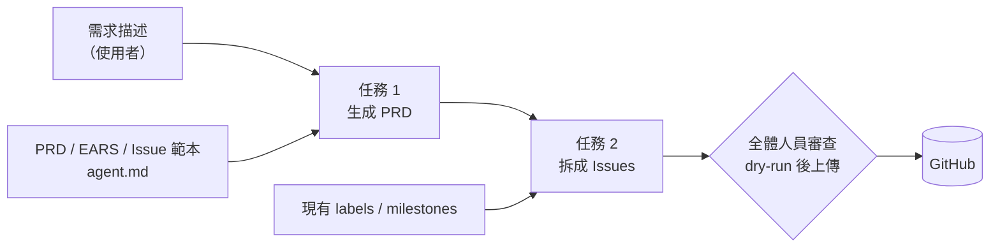

- 使用者只寫口語需求，其餘範本由系統事先提供
- **AI 只寫到 `temp/`，不直接建立 GitHub Issue**

---

## 實作：`git-issue-resolve`

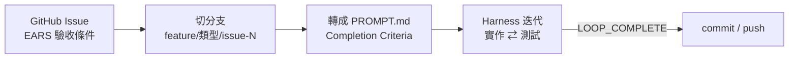

| 材料 | 怎麼給 |
|------|-------|
| Issue 內容、分支狀態、前次進度 | context（自動收集） |
| API-First 規範 | steering |
| 專案背景 `agent.md` | prompt 要求參考 |

> 單元測試在這一步完成；**做到哪裡算完成由測試判斷，不靠人盯**。

---

## 測試：API 測試由人主導

- 單元測試由 AI 寫實作時一併產生，**可能遷就實作**
- API 測試從契約推導，是**人確認「這個功能真的是我要的」的地方**
- **最後的整合測試一定由資淺工程師親自執行**
  - 實際操作的人親手驗過，才真正掌握功能
  - 也是最好的上手方式：從 request / response 理解功能全貌

> AI 可以幫忙產生 API 測試（flask-he），但判斷結果對不對的是人。

---

## 交付：`commit-message` / `pr-message`

| Hook | 主要工作 | 順手處理的事 |
|------|---------|------------|
| `commit-message` | 產生 Conventional Commits | **自動更新變更目錄的 README** |
| `pr-message` | 依範本建立 PR | 自動寫 `Closes #N`、分類變更、套用 labels |

- 文件更新綁進 commit 流程：不會再有「程式改了、README 沒改」
- PR 建立後由 CI/CD 跑測試，**資深工程師最後驗收**
- 資深工程師的時間從逐行 review，集中到最後一道把關

---

## 總整理：同一支 runner，不同 hook

| 階段 | Hook | 方法 | model | 誰確認 |
|------|------|------|-------|-------|
| 需求 / 設計 | `git-issues` | SDD | auto | 全體人員 |
| 實作 | `git-issue-resolve` | TDD + Harness | auto | 不需要人（測試判斷） |
| 測試 | flask-he | API Test First | 依設定 | 資淺工程師 |
| 交付 | `commit-message` | Conventional Commits | haiku | 有權限直接提交，否則按 y |
| 交付 | `pr-message` | PR 範本 | haiku | 資深工程師 |

> **Runner 是穩定的引擎，Hook 是可替換的任務。**
> 每個 hook 只有三個檔：`<name>.json`、`<name>.prompt.md`、`<name>.context.sh`

---

<!-- 第 4 部分 -->

**Step 4 / 7 · Simplify the Complex**

# 4. Runner 的設計
## 以簡馭繁：一支 script 貫通所有階段

---

## 從一行指令出發

```bash
kiro-cli chat --no-interactive --trust-all-tools "$(cat tasks/hello.prompt.md)"
```

| 痛點 | 設計 |
|------|------|
| 任務寫死、不知道有哪些任務 | 任務註冊表 |
| 每個任務要不同 model | Metadata 與設定優先序 |
| AI 看不到現況 | Context Script 介面 |
| 規範每次重貼、不知道 AI 收到什麼 | Steering、組裝順序、dry-run |
| 換目錄就壞、掛進別的專案出問題 | 可攜性與安全 |

> 原則：runner 的輸出是「一個指令＋一份 prompt」，**可以不呼叫 AI 就被測試**。

---

## 註冊、設定、介面

**任務註冊表（約定優於設定）**
- 檔案存在 = 一個 hook，新增任務不改 runner
- hook 名稱後的參數原樣轉交（`HOOK_ARGS`），由 hook 自己解讀

**設定優先序：CLI 旗標 > JSON > 工具預設**
- metadata 放 JSON，長 prompt 放 `.md`

**Context Script 介面**
- runner → script：環境變數；script → runner：stdout
- 失敗不中斷，附上 `(context collection failed)`
- `=== SECTION ===` 分段，prompt 用名稱引用：**這也是介面**

---

## 組裝順序與 dry-run

```
┌─ ## 規範（Steering）    ← 最穩定、最高層的約束
├─ <prompt.md 內容>        ← 任務
├─ ## 上下文資訊           ← 最易變、量最大的資料
└─ ## 工具路徑資訊（Nested 時）
```

- **指令在前、資料在後**：AI 先知道規則，比較不會被大量資料帶偏
- 資料加標題放最後：降低 prompt injection 風險（無法完全消除）
- **`--dry-run`**：不呼叫 AI、不動 git，是 prompt 的除錯器與 review 工具

---

## 可攜性與安全

```
my-flask-project/          ← REPO_ROOT（規範、現況、AI 的工作目錄）
└── ai-dev-tools/          ← TOOLS_ROOT（runner、tasks、範本）
```

| 決策 | 理由 |
|------|------|
| 整支包進函式，用 `return` | 被 `source` 也不會關掉終端機 |
| Nested mode 注入工具路徑 | AI 知道工具內的檔案在哪 |
| steering 路徑相對 `REPO_ROOT` | 規範屬於專案，不屬於工具 |
| 回傳 AI 工具的 exit code | CI 能判斷失敗 |

---

<!-- 第 5 部分 -->

**Step 5 / 7 · Implement a Full Cycle**

# 5. 實戰
## 會議記錄彙整系統

上傳逐字稿 → Bedrock（Claude）彙整摘要與與會者 → SES 寄信通知

所有指令都在 **repo 根目錄**執行

---

## 全貌：0 → 10 共 11 個步驟

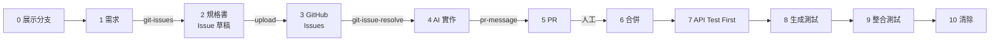

| 步驟 | 指令 | 人要確認 |
|:---:|------|---------|
| 0 | `git checkout -b demo/run-1 demo-baseline` | 起點是乾淨的基準 |
| 2 | `hook git-issues` | 待確認事項、Issue 拆分 |
| 3 | `upload-issues.sh --dry-run` | 上傳清單 |
| 4 | `hook git-issue-resolve <N>` | diff、測試結果 |
| 5–6 | `hook pr-message demo/run-1` | **base 是 `demo/run-1`**、按下 Merge |
| 8–9 | `run.sh`、`flask_function_wrapper.py` | **真實呼叫是否正常** |

---

## 開場前：確認環境

```bash
source .venv/bin/activate                                  # Python 虛擬環境
alias hook='bash ai-dev-tools/scripts/hooks/kiro-hook-run.sh'

gh auth status                                             # GitHub 已登入
kiro-cli whoami                                            # Kiro 已登入
hook --list                                                # 列出 git-issues、git-issue-resolve…
hook commit-message --dry-run | head -20                   # 只組 prompt，不呼叫 AI、不動 git
ls -l .kiro/steering/                                      # api-first-workflow.md 存在
git check-ignore -v ai-dev-tools                           # 工具集被 .gitignore 排除
```

- 安裝步驟見 README「安裝設定」1–8
- `--dry-run` 先確認 Runner 抓到的現況與規範是否正確

---

## 步驟 0：切換展示分支

```bash
# 從遠端（origin）把所有 tag 抓到本機
git fetch --tags
# 用 demo-baseline 這個 tag 當起點
git checkout -b demo/run-1 demo-baseline
git push -u origin demo/run-1
```

- `demo-baseline` 是事先打好的基準 tag（README 第 9 步 (1)）
- 每次展示從它開一條新分支，`develop` 永遠保持乾淨
- 之後所有 PR 都合併進 `demo/run-1`，**不要合進 `develop`**
- `git-issue-resolve` 從**目前分支**切出 feature 分支：實作前一定要在 `demo/run-1`

---

## 步驟 1：撰寫需求 `temp/user_reps/request.md`

用口語寫就好，不需要寫成規格：

- 上傳會議記錄，用 Claude 彙整（附上完整的彙整提示詞）
- `POST /api/meeting-minute`：傳入檔案，回傳會議摘要與與會者（姓名、Email）
- `POST /api/notify`：傳入摘要與與會者，用 AWS SES（`ap-southeast-1`）寄信
- 「本機有設定好的 AWS profile，不用考慮權限問題」

**要注意**
- `git-issues` 會讀 `temp/user_reps/` 底下**所有** `.md`：只留這一輪的需求檔
- `temp/` 不進版控，要重複使用的需求請另外備份
- 指定模型時，要確認該模型在使用的區域可用（步驟 9 會看到）

---

## 步驟 2：生成規格書並切割 Issue

```bash
hook git-issues --dry-run | less     # 先看 AI 會收到什麼（不呼叫 AI、不動 git）
hook git-issues                      # 實際執行
```

| 任務 | 範本 | 產出 |
|------|------|------|
| 1. 需求 → 規格書（10 章節） | `user_requirement.md` | `temp/user_reps_report/system_requirement_<日期>.md` |
| 2. 規格書 → Issue 草稿 | `feature_request_ears.md` | `temp/github-issues/NN-<名稱>.md` |

- 每個 Issue 有 front matter（title、labels、milestone）與 EARS 驗收條件
- Milestone 依規格書第 8 節；label 只用現有的，缺的寫在「建議新增 Label」

**人要確認**：規格書第 9 節「待確認事項」、Issue 拆分與依賴順序、label 與 milestone

---

## 步驟 3：上傳 Issue

```bash
bash ai-dev-tools/gh-issue/scripts/upload-issues.sh --dry-run   # 先看會建立什麼
bash ai-dev-tools/gh-issue/scripts/upload-issues.sh             # 確認後正式上傳
gh issue list
```

1. 掃描「建議新增 Label」，加進快照
2. 建立 GitHub 上缺少的 label、milestone
3. 依檔名順序建立 Issue（`01-…` 成為 #1）

- **Issue 與 PR 共用同一組編號**：Issue 是 #1～#5，PR 就從 #6 開始
- 不需要事先 `gh label create`

---

## 步驟 4：依 Issue 實作

```bash
git branch --show-current            # 必須在 demo/run-1
hook git-issue-resolve 1 --dry-run   # 確認抓到 Issue 內容、沒有 steering 警告
hook git-issue-resolve 1             # 可一次給多個編號：hook git-issue-resolve 1 2
```

AI 的步驟：
1. 切分支 `feature/{type}/issue-N`（type 依 label：backend / frontend / infra / docs）
2. 建立 `PROMPT.md`（含 Completion Criteria）與 `scratchpad.md`
3. 啟動 harness 迭代，最多 10 輪，出現 `LOOP_COMPLETE` 結束
4. commit（含 `Closes #N`）→ push

```bash
cat ai-dev-tools/harness-engineering/issues/issue-1/scratchpad.md   # AI 每一輪做了什麼
git diff demo/run-1 --stat
```

---

## 步驟 5：建立 PR

```bash
git branch --show-current            # 必須在 feature/infra/issue-1
hook pr-message demo/run-1           # 參數就是 PR 的 base 分支
```

- 依範本產生描述，從分支名稱自動寫上 `Closes #1`
- 依變更路徑判斷並套用 label（沒有的會自動建立）
- `gh pr create --base demo/run-1 …`，完成後**切回 base 分支**
- **只建立 PR，不會合併**

> ⚠ AI 完成時提示的是 `pr-message develop`，**展示時不要照抄**：
> 照做會把 PR 開到 `develop`，污染開發分支。

---

## 步驟 6：審核並合併

在 GitHub 的 PR 頁面：看 **Files changed** → 確認 **base 是 `demo/run-1`** → Approve → **Merge**

```bash
gh issue close 1                     # 合併進非預設分支，Issue 不會自動關閉
git checkout demo/run-1 && git pull  # 本機同步，否則下一個 Issue 缺內容
```

| 動作 | 結果 |
|------|------|
| Approve | 只是審核通過，PR 仍是 open |
| Merge | 把 feature 分支合併進 base |

**開錯 base 而且已合併**：在本機 `develop` 仍是基準時，`git push --force-with-lease origin develop` 還原遠端，再 `gh issue reopen <N>`（會改寫遠端歷史，先確認沒人在用）

---

## 步驟 7：API Test First，兩類 Issue 依序處理

| 類型 | 常見標籤 | 本次 | 實作後要做什麼 |
|------|---------|------|--------------|
| 7.1 API spec 文件 | `documentation`、`backend` | #2 端點文件 | 跑 **API-First 工具鏈** |
| 7.2 實作 API spec 的程式碼 | `backend` | #3 `/api/meeting-minute` | 做**步驟 8、9** |

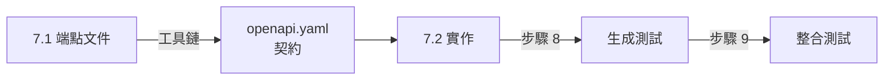

```bash
git checkout demo/run-1 && git pull  # 確認已包含前一個 Issue 的合併結果
hook git-issue-resolve <N>           # 兩類都用同一個指令
```

---

## 7.1 API spec 文件：跑 API-First 工具鏈

```bash
T=ai-dev-tools/scripts/apispec
python $T/lint-endpoints.py      # 0. 端點文件是否符合 API_REFERENCE_TEMPLATE.md
python $T/build-reference.py     # 1. endpoint/*.md + metadata.yaml → API_REFERENCE.md
python $T/md-to-openapi.py       # 2. → openapi.yaml
python $T/validate-openapi.py    # 3. 驗證 openapi.yaml
```

- `openapi.yaml` 是 7.2 實作要遵守的契約，也是 flask-he 生成整合測試的依據
- `API_REFERENCE.md`、`openapi.yaml` 是生成物，**不手改**；要改就改 `endpoint/*.md` 再重跑
- **人要確認**：端點、request / response 欄位、錯誤碼符合規格書

---

## 7.2 實作 API spec 的程式碼

| 層 | 本次產出（`feature/backend/issue-3`） |
|----|---------|
| 路由 | `routes/meeting.py`：只做 HTTP 解析與錯誤對應 |
| 業務邏輯 | `services/meeting_service.py`：檔名、副檔名、大小、編碼驗證 |
| 外部服務 | `services/llm_service.py`：**唯一** import boto3 的模組 |
| 契約 | `docs/api/endpoint/meeting.md` |
| 測試 | `backend/tests/` 下的 pytest，LLM 一律 stub |

AI 說完成之後，還要做兩件事：

1. **步驟 8**：依 `openapi.yaml` 生成單元與整合測試，契約和實作不一致就會失敗
2. **步驟 9**：`--stub` 確認程式邏輯，再真實呼叫確認環境與外部服務

---

## 步驟 8-1：生成單元測試（flask-he）

```bash
bash ai-dev-tools/harness-engineering/flask-he/run.sh --list --kind unit                 # 對象與狀態
bash ai-dev-tools/harness-engineering/flask-he/run.sh services.llm_service --kind unit   # 單一模組
bash ai-dev-tools/harness-engineering/flask-he/run.sh --all --kind unit                  # 全部（跳過已完成）
python ai-dev-tools/scripts/flask/validate_tests.py --all --kind unit                    # 品質檢查
python ai-dev-tools/scripts/flask/generate_test_report.py --kind unit --with-report      # 執行並出報告
```

- 對象來自 `flask-he-config.yaml` 的 `unit.source_include`，一個 `.py` 一個對象
- 狀態：✅ 完成、🔄 進行中、⛔ 停止、⬜ 未開始（⬜ 不代表沒有測試）
- 外部服務（`external_stubs.patch`）由 conftest 自動換成假的，不會呼叫真實 AWS

| 產物 | 位置 |
|------|------|
| 測試檔 | `backend/tests/unit/<模組路徑>/test_unit_<模組>.py` |
| 報告 | `backend/tests/unit-test-case-report.md` |

---

## 步驟 8-2：生成整合測試（flask-he）

```bash
bash ai-dev-tools/harness-engineering/flask-he/run.sh --list --kind integration
bash ai-dev-tools/harness-engineering/flask-he/run.sh meeting-minute --kind integration
python ai-dev-tools/scripts/flask/validate_tests.py meeting-minute --kind integration
python ai-dev-tools/scripts/flask/generate_test_report.py --kind integration --with-report
```

- 資源 = URL 在 `/api` 之後的第一段（`/api/meeting-minute` → `meeting-minute`）
- `--list` 的 ⚠ 提醒**契約有、實作沒有**的端點：API-First 讓落差被看見
- `docs/api/endpoint/` 只放本專案要實作的端點，範例放 `docs/api/examples/`

| 產物 | 說明 |
|------|------|
| `requests/NN_MM_<說明>.json` | 一個檔一個 HTTP 請求 |
| `event_hooks.json`／`.py` | 請求檔中 `{{名稱}}` 的值 |
| `stubs.json` | 可 stub 的函式範本（給人與 AI 參考） |

---

## 步驟 9：同一個請求，三種模式

```bash
W=ai-dev-tools/scripts/flask/flask_function_wrapper.py
python $W meeting-minute 01_01_summarize_meeting_minute.json                 # 真實呼叫
python $W meeting-minute 01_01_summarize_meeting_minute.json --otel          # 真實呼叫 + 呼叫鏈
python $W meeting-minute 01_01_summarize_meeting_minute.json --otel --stub   # 固定回傳值
```

| 模式 | 外部服務 | 耗時 | 用途 |
|------|---------|:---:|------|
| 不加參數 | **真實呼叫** Bedrock | 數秒到數十秒 | 確認 LLM 真的能用 |
| `--otel` | 真實呼叫＋呼叫鏈 | 相近 | 看時間花在哪 |
| `--otel --stub` | `_stubs` 的固定值 | 毫秒級 | 快速迴歸、看流程 |

```
🔭 Trace: POST /api/meeting-minute (8.50ms)
   └─ routes/meeting.py:meeting_minute
      └─ services/meeting_service.py:summarize
         └─ 🔇 stub services.llm_service.generate_meeting_minute
```

---

## 步驟 9：真實呼叫的前置條件與完整回應

**缺一就會回 502**
1. `.venv` 已安裝 `requirements.txt`（含 `boto3`）
2. `.env` 的 `BEDROCK_MODEL_ID` 是該區域**可用**的模型
3. `.env` 設定 `AWS_PROFILE`（flask-he 會清掉 shell 中 export 的 AWS 變數）

- 同一個請求檔要在兩種模式都通過，`_expected` **只比對 `status`**：真實 LLM 每次輸出都不同
- 真實逐字稿放 `temp/test/data/`，不進版控

**看完整摘要**（wrapper 會截斷回應）

```bash
cd backend && python app.py                                                     # 終端機 1
curl -s -F "file=@temp/test/data/20260918.txt" \
  http://localhost:5001/api/meeting-minute -o temp/test/out.json                # 終端機 2
python -c "import json; d=json.load(open('temp/test/out.json')); print(d['summary']); print(d['attendees'])"
```

---

## AI 說完成，不等於真的能用

所有測試都綠燈，第一次真實執行卻連續撞到：

| # | 錯誤 | 原因 | 測試為什麼沒抓到 |
|---|------|------|---------------|
| 1 | `ModuleNotFoundError` | `.venv` 沒裝 boto3 | stub 時不會載入 |
| 2 | `ResourceNotFoundException` | 需求指定的模型已下架 | 模型只在真實呼叫時驗證 |
| 3 | `AccessDeniedException` | IAM 禁止跨區推論、`AWS_PROFILE` 被清掉 | 權限只在真實呼叫時檢查 |
| 4 | `ValidationException` | 新模型不接受 `temperature`、回應格式不同 | stub 回傳的是自己假設的格式 |

> **stub 驗證程式邏輯，真實呼叫驗證環境與外部服務。**
> 兩種都要跑，真實呼叫的結果由人判斷。

---

## 重複步驟 4～9：處理剩下的 Issue

```bash
git checkout demo/run-1 && git pull
hook git-issue-resolve <N>
# 檢視 scratchpad 與 diff
# API spec 文件（7.1）：跑 API-First 工具鏈
# 實作程式碼（7.2）：接著做步驟 8（生成測試）與步驟 9（整合測試、真實呼叫）
hook pr-message demo/run-1
# GitHub 上審核 → Merge
gh issue close <N>
```

---

## 步驟 10：清除分支，回到初始狀態

```bash
git checkout develop && git status --short                     # 先離開要刪的分支
git fetch --prune                                              # 同步遠端分支清單

# 1. 關閉所有 open Issue
gh issue list --state open --json number,title --jq '.[] | "#\(.number) \(.title)"'   # 先看清單
gh issue list --state open --json number --jq '.[].number' | xargs -I{} gh issue close {}

# 2. 刪除遠端的展示分支與 feature 分支
git branch -r -v --list 'origin/feature/*' 'origin/demo/*'     # 先看清單，記下 commit
git branch -r --list 'origin/feature/*' 'origin/demo/*' | sed 's|origin/||' | xargs git push origin --delete

# 3. 刪除本機的同名分支
git branch -v --list 'feature/*' 'demo/*'
git branch --list 'feature/*' 'demo/*' | xargs git branch -D

# 4. 確認只剩 develop 與 main
git branch -a
```

- 刪錯可用記下的 commit 重建；`temp/`、生成物、`ai-dev-tools/` **不需要清理**
- 下一輪：`git checkout -b demo/run-2 demo-baseline`

---

<!-- 第 6 部分 -->

**Step 6 / 7 · Wrap Up the Lessons**

## 6. 收尾：AI 能做到哪裡，由權限決定

```
AI（hook）：分析 diff → 產生 message
            ├─ 工作區允許 git：直接 commit + push
            └─ 權限被拒：停止，提示人執行收尾腳本
人（終端機）：看檔案清單 → 按 y → commit + push
```

- prompt 不預設 AI 能不能執行 git，由工作區權限決定
- **任何權限下都禁止**：`echo y | ...`、`push --force`、`--no-verify`、改 git config
- 不可逆、影響共享狀態的動作（push、merge、deploy）由人決定權限

> 這條線畫在哪裡，是設計每個 hook 時最重要的決定。

---

## 實戰中的三個把關點

| 把關點 | 為什麼不能交給 AI |
|--------|------------------|
| 審規格書待確認事項、Issue 拆分 | 需求是所有人的共識；出錯的模型 ID 就在這裡被問過 |
| 確認 PR 的 base、按下 Merge | AI 的提示寫的是 `develop` |
| 真實呼叫外部服務、判斷結果 | 環境、權限、模型版本只有真實執行才會暴露 |

---

## 七條設計原則

1. **Runner 是 prompt 編譯器**：可以不呼叫 AI 就被測試
2. **約定優於設定**：檔案存在即註冊
3. **介面要窄**：環境變數進、stdout 出
4. **事實來源要明確**：規範屬於專案、現況由程式收集、契約先於實作
5. **指令在前、資料在後**，資料要標示清楚
6. **一定要有 dry-run**：看得到才除錯得了、審得了
7. **AI 準備，人確認**：不可逆的動作留給人

---

<!-- 第 7 部分 -->

**Step 7 / 7 · Extend It to the Organization**

# 7. 延伸討論
## 導入 AI 是組織管理的問題

---

## AI-SDLC 的本質：開發流程的流水線

| 流水線的特徵 | AI-SDLC 的對應 |
|-------------|---------------|
| 工序切成固定的站 | 需求 → Issue → 實作 → 測試 → PR |
| 每一站有標準作業 | hook 的 prompt、範本、steering |
| 半成品有規格 | 規格書、Issue front matter、API 契約 |
| 品管站把關 | 測試全綠、lint、人工審查 |

- DORA 2025：AI 是**放大器**，放大好組織的優勢，也放大壞組織的問題 [6]
- McKinsey：「重新設計工作流程」是與 AI 獲利關聯最大的因素 [3]

---

## 歷史對照：手工紡織 → 機械紡織

| 紡織業 | 軟體開發 |
|--------|---------|
| 手工織工 | 每個人用自己的方式跟 AI 開發 |
| 機械織布機 | AI 代理人 |
| 工廠的標準工序 | AI-SDLC |
| 機械工程師、工廠管理者 | 設計流程與 hook、定義把關點的人 |

- 電力的例子：工廠只換電動機、沿用舊配置，生產力不升；**重新設計流程後**效益才出現，落差長達數十年 [1]
- 機器本身不帶來好處，**工序的重新設計才會**
- 衝擊落在人身上，而且不平均

---

## 用 ROI 評估導入

- McKinsey 2025-11：只有 39% 表示 AI 對整體獲利有影響 [4]
- 生產力 J 曲線：需要大量無形的互補投資，**初期看起來反而下降** [2]

| 成本（不只授權費） | 效益（不只寫得快） |
|------------------|------------------|
| 工具與 token 費用 | 一致性 |
| 流程與工具建置 | 教育與監督成本下降 |
| 教育訓練 | 交付週期 |
| **審查時間** | 品質（覆蓋率、缺陷、返工） |
| **失敗成本** | 文件完整度 |

> 先量基準再導入、算總成本、小範圍試行。

---

## 員工的重新定位

工作沒有消失，而是**從「做」移向「定義、審查與判斷」**

| 角色 | 導入後主要在做什麼 |
|------|-----------------|
| 全體成員 | 一起審查規格書與 Issue |
| 資淺工程師 | 親自執行整合測試，從 request / response 掌握功能 |
| 資深工程師 | 設計流程與規範、最後驗收 |
| 新角色：流程維護者 | 維護 hook、範本、steering、工具集 |

**員工的三個顧慮** [12]

| 顧慮 | AI-SDLC 的回應 |
|------|---------------|
| 不確定 AI 會做什麼 | `--dry-run` 公開 prompt；scratchpad 公開每一輪 |
| 害怕被取代 | 明確定義每個角色的把關點 |
| 害怕看起來能力不足 | 把「審查 AI 產出」「判斷真實結果」列為正式工作與評量項目 |

---

## 組織的重新定位

| 面向 | 要重新思考的問題 |
|------|-----------------|
| 流程的擁有者 | 誰能修改 hook 與範本？ |
| 權限與治理 | AI 能直接 push 到哪些分支？ |
| 責任歸屬 | AI 產出的程式出問題，誰負責？ |
| 評量方式 | 看需求品質、審查品質，不只看產量 |
| 知識保存 | 規範寫進 steering，人員流動時不會帶走 |
| 中階主管 | 需要明確的授權與支援 [10] |

> **AI-SDLC 改變的是生產方式，不只是工具。**

---

## 討論題

1. 你的團隊在 AI 等級 1–5 的哪裡？缺的是技術，還是流程與管理？
2. 提案導入時，你會量哪三個基準指標？
3. 哪種工作最可能被 AI 取代？做這份工作的人下一步往哪走？
4. 資淺工程師不再親手寫大部分程式，要靠什麼累積能力？
5. AI 產出的程式造成事故，責任怎麼分配？防線加在哪？
6. 盧德運動反對的是機器，還是機器帶來的分配改變？

---

## 參考文獻（節錄）

1. Paul A. David. "The Dynamo and the Computer." *AER*, 1990.
2. Brynjolfsson, Rock, Syverson. "The Productivity J-Curve." NBER, 2018.
3. McKinsey. "The state of AI: How organizations are rewiring to capture value." 2025-03.
4. McKinsey. "The state of AI in 2025." 2025-11.
6. Google DORA. "2025 State of AI-assisted Software Development."
10. HBR. "AI Adoption Is Overloading Your Middle Managers." 2026-06.
12. HBS AI Institute. "The People, Processes, and Politics of AI ROI." 2026.

完整清單與連結見 [AI-SDLC-實戰課程.md §7.7](./AI-SDLC-實戰課程.md)

---

# Q&A

**AI 準備，人確認。**
照著流程走，就是照著規範做。

---

<!-- 業配：EZ-Deploy -->

# 做完了，然後呢？
## 讓作品上線：EZ-Deploy

用 AI-SDLC 做出的作品，下一步是**讓別人用得到**。

- 不用自己架伺服器，也不用處理複雜的部署
- 把網頁檔案上傳到平台，就能產生瀏覽連結，直接分享給客戶、同事或合作夥伴
- 作品頁、活動頁、產品介紹頁、臨時測試頁，都可以快速發布、隨時更新
- 提供 Email 通知服務：表單送出就寄信，不必自己寫寄信後端（範例：`uniheart-tw/EZ-Deploy-demo` 點餐系統）

**官方網站（可免費試用）**：https://shop.uniheart.com.tw/

---

## EZ-Deploy 教學影片

| 拖拉上傳，作品直接上線 | 解鎖付費功能，讓作品可以收費 |
|:---:|:---:|
| [](https://youtu.be/LTV4pbzrEnM) | [](https://youtu.be/-QqIpKLV-5Y) |
| **EZ-Deploy 基本使用教程** | **EZ-Deploy 付費解鎖功能** |
| https://youtu.be/LTV4pbzrEnM | https://youtu.be/-QqIpKLV-5Y |

> 從**做出來**、**放上去**，到**收得到錢**：一個人也能把想法變成產品。

**官方網站**：https://shop.uniheart.com.tw/
