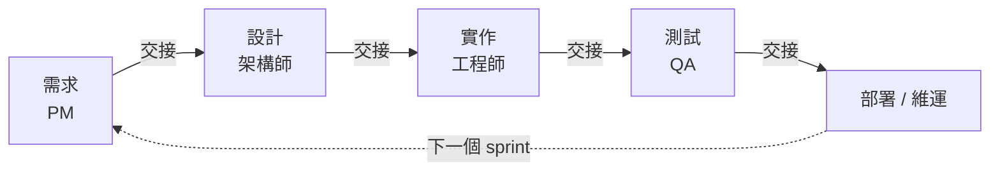
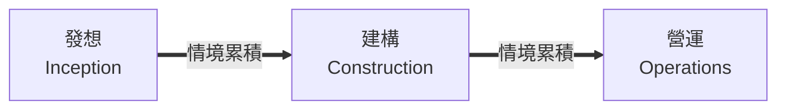
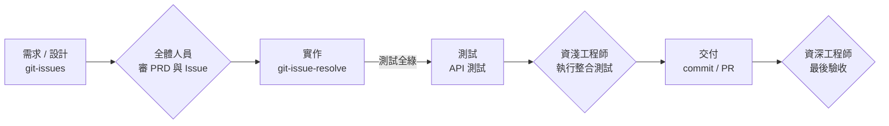
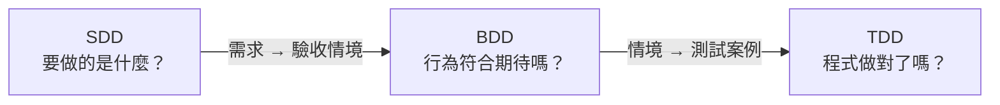
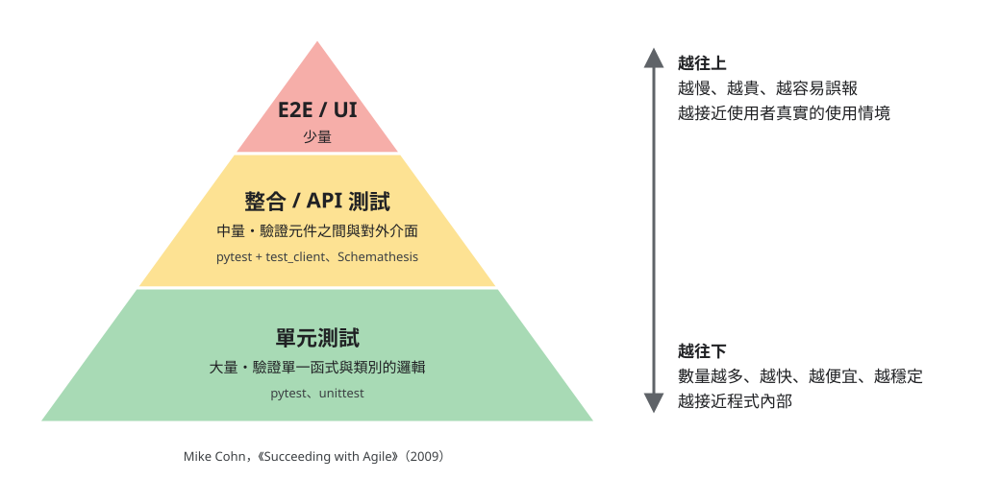
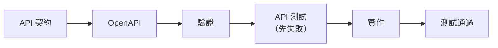
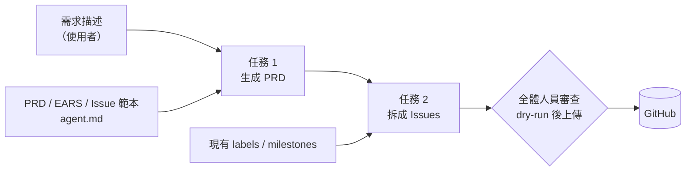
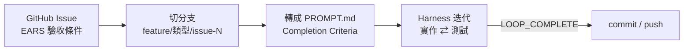
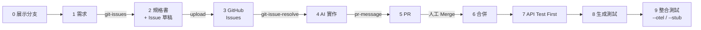

# AI-SDLC
## AI 驅動的軟體開發生命週期（Python Flask 篇）

> 我們不是為了技術而導入 AI，是為了管理。

完整內容：[AI-SDLC-實戰課程.md](./AI-SDLC-實戰課程.md)

---

## 議程

1. 開場：為什麼要 AI-SDLC
2. 預備觀念：SDLC × AI-DLC × AI-SDLC、TDD / BDD / SDD、測試金字塔、API Test First、Harness
3. 拆解：每個階段的 hook 需要哪些材料
4. Runner 的設計
5. 實戰：會議記錄彙整系統
6. 收尾：人機邊界與設計原則
7. 延伸討論：導入 AI 是組織管理的問題

---

## 貫穿全場的三個問題

1. **介面是什麼？** CLI、runner ↔ context script、prompt ↔ context 段落名稱
2. **誰是事實來源？** prompt 檔、JSON、專案 steering、Flask 路由、API 契約
3. **人在哪裡把關？** dry-run 審 prompt、審 Issue、審 PR、判斷真實執行結果

---

<!-- 第 1 部分 -->

# 1. 開場
## 為什麼要 AI-SDLC

---

## 人類對 AI 的期望：OpenAI 的五個等級

| 等級 | 名稱 | 能做到什麼 |
|:---:|------|-----------|
| 1 | 聊天機器人 | 用自然語言對話 |
| 2 | 推理者 | 解決基本問題 |
| 3 | 代理人 | 代表使用者執行任務 |
| 4 | 創新者 | 協助發明與創新 |
| 5 | 組織 | 不需人介入，完成整個組織的工作 |

- 寫程式已進入第 3 級：AI 能讀檔、改程式、跑測試、commit
- 第 5 級「完全交給 AI」不切實際：能力再強，組織也不會把管理完全授權給沒有監督的對象，對人對 AI 都一樣
- AI-SDLC 的詮釋：組織等級的 AI 是**把 AI 融入組織活動**，AI 負責產出，人負責定義、審查與判斷
- **所以問題變成管理問題：怎麼讓 AI 照規範做事，人在哪裡把關**

<small>出處：Bloomberg（2024-07-11）。這是 OpenAI 內部分類，不是業界標準。</small>

---

## 問題：每個人都用自己的方式跟 AI 開發

| 現象 | 管理上的後果 |
|------|------------|
| 交談式開發 | 同一件事，兩個人做出兩種樣子 |
| 零散 | 需求和程式對不起來 |
| 沒有規範 | 只能靠 code review 事後抓 |
| 參與者流動 | 每來一個人就要重新教、持續盯 |

> 問題不在 AI 不夠聰明，而在**每個人用 AI 的方式都不一樣**。

---

## 傳統解法 vs. 我們的解法

**傳統：教育與監督**
寫規範、辦訓練、code review、指定專人監督：成本高、事後才發現、規模大就管不動

**AI-SDLC：把規範內建在流程裡**

| 以前靠人 | 現在靠流程 |
|---------|-----------|
| 教大家寫需求 | AI 照 PRD、EARS、Issue 範本產生 |
| 提醒先寫測試 | 測試沒過就不算完成 |
| 盯 commit 格式 | 一律產生 Conventional Commits，順便更新 README |
| 檢查 PR 有沒有連 Issue | 從分支名稱自動寫上 `Closes #N` |

> 目標是**專案的一致性**：人從「教育與監督」轉為「在固定的點上確認」。

---

## 要補上 AI 的三個盲點

| AI 不擅長 | 流程要提供的 |
|----------|------------|
| 知道專案沒寫下來的潛規則 | **規範**：範本、開發方法、專案背景 |
| 自己找現在的 diff、Issue、路由表 | **現況**：每次自動收集的上下文 |
| 判斷什麼時候算完成 | **完成條件**：可以自動驗證的測試 |

---

<!-- 第 2 部分 -->

# 2. 預備觀念

---

## 傳統 SDLC：人主導、分工交接



- AI 只是輔助工具：補全程式、產生文件
- 流程本身沒有改變，交接、會議、文件仍由人負責

---

## 對照組：AWS AI-DLC

**以開發速度為目標，重新設計整個生命週期**：3 個階段、9 個步驟



- 每個活動都是：AI 擬計畫 → AI 提問 → **人確認** → AI 執行
- 重新定義儀式：Sprint → **Bolt**（以小時或天計）、Epic → **Unit of Work**
- 團隊以 Mob Elaboration / Mob Construction 一起確認 AI 的提案

---

## 我們的 AI-SDLC：沿用 SDLC，把方法內建進每個階段



---

## 每個階段：誰把關、內建什麼方法

| 階段 | 誰確認 | 內建的方法 | 參與者不用再被教的事 |
|------|-------|-----------|------------------|
| 需求 / 設計 | **全體人員** | SDD：PRD、EARS、Issue 格式 | 需求怎麼寫、Issue 怎麼拆 |
| 實作 | **不需要人** | TDD + Harness | 做到哪裡算完成 |
| 測試 | **資淺工程師**執行最後整合測試 | API Test First | 要測哪些情境、錯誤碼 |
| 交付 | CI/CD + **資深工程師**驗收 | Conventional Commits、PR 範本 | commit / PR 格式、文件更新 |

> 每個階段的產物都存在 repo 或 GitHub，下一個 hook 再把它收集交給 AI，**整條流程串在一起**。

---

## 三者比較

| 面向 | 傳統 SDLC | AWS AI-DLC | AI-SDLC |
|------|----------|-----------|---------|
| 出發點 | — | **開發速度** | **專案管理、一致性** |
| 階段 | 6 階段 | 3 階段 9 步驟 | 沿用 SDLC |
| 開發方法放哪 | 文件與訓練 | Mob 儀式中確認 | **寫進每個 hook** |
| 工作拆分 | Epic / Story | Unit of Work | GitHub Issue |
| 對參與者的要求 | 自律遵守 | 參與 Mob 儀式 | **會用流程即可** |

> AI-DLC 為了速度重新設計流程；AI-SDLC 為了管理，把方法內建在現有流程裡。
> 兩者出發點不同，但都採用「AI 產出、人確認」「情境逐步累積」「產物存進專案」。

---

## TDD / BDD / SDD：先定義對，再寫程式



| | TDD | BDD | SDD |
|---|-----|-----|-----|
| 參與者 | 開發者 | 開發、PM、QA | PM、架構師、開發者、AI |
| 規範 | AAA、測試命名 | Gherkin | EARS、PRD、OpenAPI |
| 弱點 | 只證明程式符合測試 | 情境多時維護成本高 | 規格不會執行 |

---

## 同一條需求的三種寫法

**SDD（EARS）**
`If 使用者連續輸入錯誤密碼 5 次, then the system shall 鎖定帳號 15 分鐘。`

**BDD（Gherkin）**
```gherkin
Scenario: 連續輸入錯誤密碼後鎖定帳號
  Given 使用者帳號已連續登入失敗 4 次
  When 使用者再次輸入錯誤密碼
  Then 帳號被鎖定 15 分鐘
```

**TDD（AAA）**
```python
def test_login_locks_account_after_five_failures():
    account = Account(failed_attempts=4)          # Arrange
    result = login(account, password="wrong")     # Act
    assert result.locked_minutes == 15            # Assert
```

> 三者不互相取代，而是一路推導。

---

## 測試金字塔：測試要分層



| 層級 | 驗證什麼 | 工具（Python） |
|------|---------|---------------|
| E2E / UI | 使用者完整流程 | Playwright |
| 整合 / API | 元件之間、HTTP API | pytest + `test_client`、Schemathesis |
| 單元 | 單一函式的邏輯 | pytest |

> 重點不是固定比例，而是**每一層都要有，並知道它在保護什麼**。

---

## API Test First：補上 TDD 與 SDD 的弱點


- TDD 的弱點：AI 同時寫實作和單元測試，等於**自己出題自己考**
- SDD 的弱點：契約寫得再好，沒有測試去比對就管不住實作
- **API 測試從契約推導，在實作之前先寫好**

---

## 為什麼要 API Test First

1. **測試與實作獨立**：從契約推導，不從實作推導
2. **讓規格有約束力**：契約變成可執行的檢查
3. **最穩定的護欄**：內部怎麼重構，契約不變測試就不用改
4. **人看得懂**：request / response 是人掌握功能的抓手
5. **成本甜蜜點**：比 E2E 快又穩，比單元測試更接近真實行為
6. **前後端可平行開發**



---

## Harness Engineering：讓 AI 自己修到過


- Verifier **是程式不是 AI**，AI 不能改門檻
- `scratchpad.md` 跨輪保存進度
- **Runner 負責組好一次執行，Harness 負責重複到通過**

---

<!-- 第 3 部分 -->

# 3. 拆解
## 每個階段要交給 AI 哪些材料

---

## 五個元件

```
┌──────────────────────────────────────────┐
│ agent    誰在做、有什麼權限    ← 指令旗標   │
│ model    用多聰明的腦         ← 指令旗標   │
├──────────────────────────────────────────┤
│ steering 遵守什麼規範         ← prompt 最前 │
│ prompt   做什麼任務          ← prompt 中間 │
│ context  看到什麼現況資料     ← prompt 最後 │
└──────────────────────────────────────────┘
```

- 目前實際用到：model、steering、prompt、context
- 簡單任務（commit、PR）用 haiku，需求分析與實作用 auto
- steering 由 runner 直接注入，**保證 AI 一定看得到**；寫在 prompt 裡要求 AI 去讀，則看 AI 自己

---

## 需求 / 設計：`git-issues`



- 使用者只寫口語需求，其餘範本由系統事先提供
- **AI 只寫到 `temp/`，不直接建立 GitHub Issue**

---

## 實作：`git-issue-resolve`



| 材料 | 怎麼給 |
|------|-------|
| Issue 內容、分支狀態、前次進度 | context（自動收集） |
| API-First 規範 | steering |
| 專案背景 `agent.md` | prompt 要求參考 |

> 單元測試在這一步完成；**做到哪裡算完成由測試判斷，不靠人盯**。

---

## 測試：API 測試由人主導

- 單元測試由 AI 寫實作時一併產生，**可能遷就實作**
- API 測試從契約推導，是**人確認「這個功能真的是我要的」的地方**
- **最後的整合測試一定由資淺工程師親自執行**
  - 實際操作的人親手驗過，才真正掌握功能
  - 也是最好的上手方式：從 request / response 理解功能全貌

> AI 可以幫忙產生 API 測試（flask-he），但判斷結果對不對的是人。

---

## 交付：`commit-message` / `pr-message`

| Hook | 主要工作 | 順手處理的事 |
|------|---------|------------|
| `commit-message` | 產生 Conventional Commits | **自動更新變更目錄的 README** |
| `pr-message` | 依範本建立 PR | 自動寫 `Closes #N`、分類變更、套用 labels |

- 文件更新綁進 commit 流程：不會再有「程式改了、README 沒改」
- PR 建立後由 CI/CD 跑測試，**資深工程師最後驗收**
- 資深工程師的時間從逐行 review，集中到最後一道把關

---

## 總整理：同一支 runner，不同 hook

| 階段 | Hook | 方法 | model | 誰確認 |
|------|------|------|-------|-------|
| 需求 / 設計 | `git-issues` | SDD | auto | 全體人員 |
| 實作 | `git-issue-resolve` | TDD + Harness | auto | 不需要人（測試判斷） |
| 測試 | flask-he | API Test First | 依設定 | 資淺工程師 |
| 交付 | `commit-message` | Conventional Commits | haiku | 有權限直接提交，否則按 y |
| 交付 | `pr-message` | PR 範本 | haiku | 資深工程師 |

> **Runner 是穩定的引擎，Hook 是可替換的任務。**
> 每個 hook 只有三個檔：`<name>.json`、`<name>.prompt.md`、`<name>.context.sh`

---

<!-- 第 4 部分 -->

# 4. Runner 的設計

---

## 從一行指令出發

```bash
kiro-cli chat --no-interactive --trust-all-tools "$(cat tasks/hello.prompt.md)"
```

| 痛點 | 設計 |
|------|------|
| 任務寫死、不知道有哪些任務 | 任務註冊表 |
| 每個任務要不同 model | Metadata 與設定優先序 |
| AI 看不到現況 | Context Script 介面 |
| 規範每次重貼、不知道 AI 收到什麼 | Steering、組裝順序、dry-run |
| 換目錄就壞、掛進別的專案出問題 | 可攜性與安全 |

> 原則：runner 的輸出是「一個指令＋一份 prompt」，**可以不呼叫 AI 就被測試**。

---

## 註冊、設定、介面

**任務註冊表（約定優於設定）**
- 檔案存在 = 一個 hook，新增任務不改 runner
- hook 名稱後的參數原樣轉交（`HOOK_ARGS`），由 hook 自己解讀

**設定優先序：CLI 旗標 > JSON > 工具預設**
- metadata 放 JSON，長 prompt 放 `.md`

**Context Script 介面**
- runner → script：環境變數；script → runner：stdout
- 失敗不中斷，附上 `(context collection failed)`
- `=== SECTION ===` 分段，prompt 用名稱引用：**這也是介面**

---

## 組裝順序與 dry-run

```
┌─ ## 規範（Steering）    ← 最穩定、最高層的約束
├─ <prompt.md 內容>        ← 任務
├─ ## 上下文資訊           ← 最易變、量最大的資料
└─ ## 工具路徑資訊（Nested 時）
```

- **指令在前、資料在後**：AI 先知道規則，比較不會被大量資料帶偏
- 資料加標題放最後：降低 prompt injection 風險（無法完全消除）
- **`--dry-run`**：不呼叫 AI、不動 git，是 prompt 的除錯器與 review 工具

---

## 可攜性與安全

```
my-flask-project/          ← REPO_ROOT（規範、現況、AI 的工作目錄）
└── ai-dev-tools/          ← TOOLS_ROOT（runner、tasks、範本）
```

| 決策 | 理由 |
|------|------|
| 整支包進函式，用 `return` | 被 `source` 也不會關掉終端機 |
| Nested mode 注入工具路徑 | AI 知道工具內的檔案在哪 |
| steering 路徑相對 `REPO_ROOT` | 規範屬於專案，不屬於工具 |
| 回傳 AI 工具的 exit code | CI 能判斷失敗 |

---

<!-- 第 5 部分 -->

# 5. 實戰
## 會議記錄彙整系統

上傳逐字稿 → Bedrock（Claude）彙整摘要與與會者 → SES 寄信通知

---

## 全貌



所有 PR 都合併進展示分支 `demo/run-1`，不碰 `develop`。

---

## 步驟 1–3：需求 → 規格書 → Issue

```bash
hook git-issues --dry-run    # 先看 AI 會收到什麼
hook git-issues              # 產生規格書與 Issue 草稿
bash ai-dev-tools/gh-issue/scripts/upload-issues.sh --dry-run
```

- 需求用口語寫：兩個 API `/api/meeting-minute`、`/api/notify`
- 規格書 10 個章節；Issue 依 EARS 寫驗收條件
- 本次拆成 5 個 Issue：infra、API 文件、兩個 backend、frontend

**人要確認**
1. 規格書第 9 節「待確認事項」：本次第 1 項就是後來出錯的**模型 ID**
2. Issue 拆分與依賴順序
3. label、milestone 沒有亂開

---

## 步驟 4–6：實作 → PR → 合併

```bash
hook git-issue-resolve 1          # 切分支、迭代實作、commit/push
hook pr-message demo/run-1        # 建立 PR（只建立，不合併）
```

- AI 切出 `feature/infra/issue-1`，在 `scratchpad.md` 記錄每一輪
- PR 自動寫上 `Closes #1`、分類變更、套用 label
- **Merge 由人在 GitHub 上按下**

**實戰教訓**
- AI 完成時提示 `pr-message develop`，照做就把 PR 開到開發分支
- 合併進非預設分支時，Issue **不會**自動關閉
- 合併後本機要 `git pull`，否則下一個 Issue 缺內容

---

## 步驟 7：複雜的 Issue 用 API Test First

```bash
python $T/lint-endpoints.py       # 端點文件符合範本
python $T/build-reference.py      # 合併 → API_REFERENCE.md
python $T/md-to-openapi.py        # → openapi.yaml
python $T/validate-openapi.py     # 驗證
```

| 層 | 本次產出 |
|----|---------|
| 路由 | `routes/meeting.py`：只做 HTTP 解析 |
| 業務邏輯 | `services/meeting_service.py`：檔名、大小、編碼驗證 |
| 外部服務 | `services/llm_service.py`：**唯一** import boto3 的模組 |
| 契約 | `docs/api/endpoint/meeting.md` |

> 契約和實作不一致，生成的測試就會失敗：這是**契約先於實作**的把關點。

---

## 步驟 8：生成單元與整合測試（flask-he）

```bash
bash ai-dev-tools/harness-engineering/flask-he/run.sh --list --kind integration
bash ai-dev-tools/harness-engineering/flask-he/run.sh meeting-minute --kind integration
python ai-dev-tools/scripts/flask/validate_tests.py meeting-minute --kind integration
```

- 單元測試：一個模組一個對象；外部服務自動 stub
- 整合測試：一個資源一個對象，一個請求檔一個 HTTP 請求
- `--list` 的 ⚠ 提醒**契約有、實作沒有**的端點：API-First 讓落差被看見
- 本次整合測試：5 passed、覆蓋率 83.3%

---

## 步驟 9：同一個請求，三種模式

| 模式 | 外部服務 | 耗時 | 用途 |
|------|---------|:---:|------|
| 不加參數 | **真實呼叫** Bedrock | 約 50 秒 | 確認 LLM 真的能用 |
| `--otel` | 真實呼叫 + 呼叫鏈 | 相近 | 看時間花在哪 |
| `--otel --stub` | 固定回傳值 | 約 8 毫秒 | 快速迴歸、看流程 |

```
🔭 Trace: POST /api/meeting-minute (8.50ms)
   └─ routes/meeting.py:meeting_minute
      └─ services/meeting_service.py:summarize
         ├─ parse_meeting_date
         └─ 🔇 stub services.llm_service.generate_meeting_minute
```

---

## AI 說完成，不等於真的能用

所有測試都綠燈，第一次真實執行卻連續撞到：

| # | 錯誤 | 原因 |
|---|------|------|
| 1 | `ModuleNotFoundError` | `.venv` 沒裝 boto3（stub 時不會載入） |
| 2 | `ResourceNotFoundException` | 需求指定的模型已下架 |
| 3 | `AccessDeniedException` | IAM 禁止跨區推論、`AWS_PROFILE` 被清掉 |
| 4 | `ValidationException` | 新模型不接受 `temperature`、回應格式不同 |

> **stub 驗證程式邏輯，真實呼叫驗證環境與外部服務。**
> 兩種都要跑，真實呼叫的結果由人判斷。

---

<!-- 第 6 部分 -->

# 6. 收尾
## 人機邊界與設計原則

---

## AI 能做到哪裡，由權限決定

```
AI（hook）：分析 diff → 產生 message
            ├─ 工作區允許 git：直接 commit + push
            └─ 權限被拒：停止，提示人執行收尾腳本
人（終端機）：看檔案清單 → 按 y → commit + push
```

- prompt 不預設 AI 能不能執行 git，由工作區權限決定
- **任何權限下都禁止**：`echo y | ...`、`push --force`、`--no-verify`、改 git config
- 不可逆、影響共享狀態的動作（push、merge、deploy）由人決定權限

> 這條線畫在哪裡，是設計每個 hook 時最重要的決定。

---

## 實戰中的三個把關點

| 把關點 | 為什麼不能交給 AI |
|--------|------------------|
| 審規格書待確認事項、Issue 拆分 | 需求是所有人的共識；出錯的模型 ID 就在這裡被問過 |
| 確認 PR 的 base、按下 Merge | AI 的提示寫的是 `develop` |
| 真實呼叫外部服務、判斷結果 | 環境、權限、模型版本只有真實執行才會暴露 |

---

## 七條設計原則

1. **Runner 是 prompt 編譯器**：可以不呼叫 AI 就被測試
2. **約定優於設定**：檔案存在即註冊
3. **介面要窄**：環境變數進、stdout 出
4. **事實來源要明確**：規範屬於專案、現況由程式收集、契約先於實作
5. **指令在前、資料在後**，資料要標示清楚
6. **一定要有 dry-run**：看得到才除錯得了、審得了
7. **AI 準備，人確認**：不可逆的動作留給人

---

<!-- 第 7 部分 -->

# 7. 延伸討論
## 導入 AI 是組織管理的問題

---

## AI-SDLC 的本質：開發流程的流水線

| 流水線的特徵 | AI-SDLC 的對應 |
|-------------|---------------|
| 工序切成固定的站 | 需求 → Issue → 實作 → 測試 → PR |
| 每一站有標準作業 | hook 的 prompt、範本、steering |
| 半成品有規格 | 規格書、Issue front matter、API 契約 |
| 品管站把關 | 測試全綠、lint、人工審查 |

- DORA 2025：AI 是**放大器**，放大好組織的優勢，也放大壞組織的問題 [6]
- McKinsey：「重新設計工作流程」是與 AI 獲利關聯最大的因素 [3]

---

## 歷史對照：手工紡織 → 機械紡織

| 紡織業 | 軟體開發 |
|--------|---------|
| 手工織工 | 每個人用自己的方式跟 AI 開發 |
| 機械織布機 | AI 代理人 |
| 工廠的標準工序 | AI-SDLC |
| 機械工程師、工廠管理者 | 設計流程與 hook、定義把關點的人 |

- 電力的例子：工廠只換電動機、沿用舊配置，生產力不升；**重新設計流程後**效益才出現，落差長達數十年 [1]
- 機器本身不帶來好處，**工序的重新設計才會**
- 衝擊落在人身上，而且不平均

---

## 用 ROI 評估導入

- McKinsey 2025-11：只有 39% 表示 AI 對整體獲利有影響 [4]
- 生產力 J 曲線：需要大量無形的互補投資，**初期看起來反而下降** [2]

| 成本（不只授權費） | 效益（不只寫得快） |
|------------------|------------------|
| 工具與 token 費用 | 一致性 |
| 流程與工具建置 | 教育與監督成本下降 |
| 教育訓練 | 交付週期 |
| **審查時間** | 品質（覆蓋率、缺陷、返工） |
| **失敗成本** | 文件完整度 |

> 先量基準再導入、算總成本、小範圍試行。

---

## 員工的重新定位

工作沒有消失，而是**從「做」移向「定義、審查與判斷」**

| 角色 | 導入後主要在做什麼 |
|------|-----------------|
| 全體成員 | 一起審查規格書與 Issue |
| 資淺工程師 | 親自執行整合測試，從 request / response 掌握功能 |
| 資深工程師 | 設計流程與規範、最後驗收 |
| 新角色：流程維護者 | 維護 hook、範本、steering、工具集 |

**風險**：資淺工程師的成長路徑要刻意設計、過度信任 AI、技能貶值帶來的抗拒

---

## 回應員工的三個顧慮

| 顧慮 | AI-SDLC 的回應 |
|------|---------------|
| 不確定 AI 會做什麼 | `--dry-run` 公開 prompt；scratchpad 公開每一輪 |
| 害怕被取代 | 明確定義每個角色的把關點 |
| 害怕看起來能力不足 | 把「審查 AI 產出」「判斷真實結果」列為正式工作與評量項目 |

<small>出處：HBS AI Institute [12]</small>

---

## 組織的重新定位

| 面向 | 要重新思考的問題 |
|------|-----------------|
| 流程的擁有者 | 誰能修改 hook 與範本？ |
| 權限與治理 | AI 能直接 push 到哪些分支？ |
| 責任歸屬 | AI 產出的程式出問題，誰負責？ |
| 評量方式 | 看需求品質、審查品質，不只看產量 |
| 知識保存 | 規範寫進 steering，人員流動時不會帶走 |
| 中階主管 | 需要明確的授權與支援 [10] |

> **AI-SDLC 改變的是生產方式，不只是工具。**

---

## 討論題

1. 你的團隊在 AI 等級 1–5 的哪裡？缺的是技術，還是流程與管理？
2. 提案導入時，你會量哪三個基準指標？
3. 哪種工作最可能被 AI 取代？做這份工作的人下一步往哪走？
4. 資淺工程師不再親手寫大部分程式，要靠什麼累積能力？
5. AI 產出的程式造成事故，責任怎麼分配？防線加在哪？
6. 盧德運動反對的是機器，還是機器帶來的分配改變？

---

## 參考文獻（節錄）

1. Paul A. David. "The Dynamo and the Computer." *AER*, 1990.
2. Brynjolfsson, Rock, Syverson. "The Productivity J-Curve." NBER, 2018.
3. McKinsey. "The state of AI: How organizations are rewiring to capture value." 2025-03.
4. McKinsey. "The state of AI in 2025." 2025-11.
6. Google DORA. "2025 State of AI-assisted Software Development."
10. HBR. "AI Adoption Is Overloading Your Middle Managers." 2026-06.
12. HBS AI Institute. "The People, Processes, and Politics of AI ROI." 2026.

完整清單與連結見 [AI-SDLC-實戰課程.md §7.7](./AI-SDLC-實戰課程.md)

---

# Q&A

**AI 準備，人確認。**
照著流程走，就是照著規範做。
