# AI-SDLC 實戰課程：AI 驅動的軟體開發生命週期（Python Flask 篇）

> 本文件是本 repo 的完整課程內容：從為什麼要 AI-SDLC、預備觀念、流程拆解、工具設計，到一輪完整的實戰示範。
> 實戰部分的指令都在 repo 根目錄執行，環境請先依 [README](../../README.md) 的「前置條件」與「安裝設定」完成。

## 一句話主題

> **我們不是為了技術而導入 AI（Artificial Intelligence，人工智慧），是為了管理。**
> 每個人都用自己的方式跟 AI 交談、開發，結果是零散、沒有規範、品質不一。
> AI-SDLC（AI-driven Software Development Life Cycle，AI 驅動的軟體開發生命週期）用 AI 把整個開發流程串起來，並把開發方法內建在流程裡：**照著流程走，就是照著規範做**，不必再一個一個教育、一個一個監督。

## 你會帶走什麼

1. **為什麼要 AI-SDLC**：交談式、零散的 AI 開發帶來什麼管理問題，以及用流程確保專案一致性的思路；並拿傳統 SDLC（Software Development Life Cycle，軟體開發生命週期）與 AWS（Amazon Web Services）的 AI-DLC（AI-Driven Development Lifecycle，AI 驅動開發生命週期）對照，看清 AI-SDLC 的定位。
2. **流程內建的開發方法**：TDD（Test-Driven Development，測試驅動開發）、BDD（Behavior-Driven Development，行為驅動開發）、SDD（Spec-Driven Development，規格驅動開發）各自用什麼規格文件、測試為什麼要分層、為什麼還需要 API（Application Programming Interface，應用程式介面）Test First，以及這些方法怎麼被寫進流程。
3. **一份 SDLC 材料清單**：需求、實作、測試、交付四個階段，各要交給 AI 哪些規範、範本與現況資料，哪些是使用者寫的、哪些是系統事先準備的，人又在哪裡把關。
4. **一個心智模型**：Runner 是穩定的「prompt 編譯器」，Hook 是可替換的任務。runner 為五個元件（agent / model / steering / prompt / context）都留了位置，目前實際用到的是 model、steering、prompt、context。
5. **Runner 的關鍵設計取捨**：任務怎麼註冊、設定的優先序、context script 的介面、組裝順序、dry-run、怎麼掛進別的專案、AI 的權限邊界畫在哪。
6. **一輪完整的實戰**：用 git 分支管理展示流程、讓 LLM 依 Issue 編碼、用 harness engineering 生成單元與整合測試，並用 OpenTelemetry 觀察每個請求的呼叫鏈；以及真實執行時，哪些問題只有人才抓得到。

## 議程

1. **開場**：為什麼要 AI-SDLC：為了管理，不是為了技術
2. **預備觀念**：傳統 SDLC × AWS AI-DLC × AI-SDLC、TDD / BDD / SDD、測試金字塔、API Test First、Harness
3. **拆解**：每個 SDLC 階段的 hook 需要哪些材料
4. **Runner 的設計**：一支通用 hook runner 的關鍵設計決策
5. **實戰流程**：需求 → Issue → 實作 → PR → 合併；backend Issue 的 API Test First、測試生成與觀察性
6. **收尾**：人機邊界、設計原則、Q&A

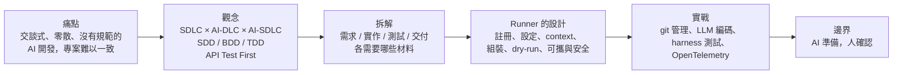

貫穿全文的三個問題，讀每一段時都可以回頭問：

1. **介面是什麼？**（CLI、runner ↔ context script、prompt ↔ context 段落名稱）
2. **誰是事實來源？**（prompt 檔、JSON、專案的 steering、Flask 的路由、API 契約）
3. **人在哪裡把關？**（dry-run 審 prompt、審 Issue、審 PR、判斷真實執行的結果）

---

## 1. 開場：為什麼要 AI-SDLC — 為了管理，不是為了技術

### 1.1 問題：每個人都用自己的方式跟 AI 開發

AI 程式助理普及之後，團隊的開發方式變成這樣：

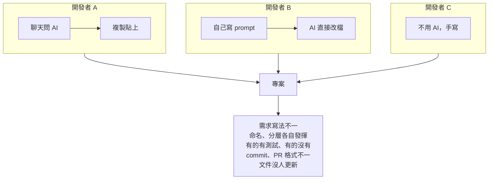

| 現象 | 管理上的後果 |
|------|------------|
| **交談式開發**：每次在聊天視窗重新解釋需求與規範 | 結果取決於當下怎麼問，同一件事兩個人做出兩種樣子 |
| **零散**：需求、設計、實作、測試、交付各自進行，沒有串起來 | 需求和程式對不起來，做完不知道有沒有漏 |
| **沒有規範**：規範寫在文件裡，但沒人保證有照做 | 只能靠 code review 事後抓，抓不完 |
| **參與者流動**：新成員、外包、實習生陸續加入 | 每來一個人就要重新教一次，還要持續盯 |

> 問題不在 AI 不夠聰明，而在**每個人用 AI 的方式都不一樣**。

### 1.2 傳統的解法：教育與監督

| 做法 | 成本 |
|------|------|
| 寫規範文件、辦教育訓練 | 要有人寫、有人教；文件會過時，看了不一定照做 |
| Code review 把關 | 資深人員的時間被大量佔用，而且是事後才發現 |
| 指定專人監督 | 人力成本高，規模一大就管不動 |

### 1.3 我們的解法：把規範內建在流程裡

**AI-SDLC 的目的：用 AI 把整個開發流程串起來，並把特定的開發方法套進每個步驟。**
參與者照著流程走，產出的需求、程式、測試、commit、PR（Pull Request，合併請求）就自然符合規範。

| 以前靠人 | 現在靠流程 |
|---------|-----------|
| 教大家怎麼寫需求 | 系統事先提供 PRD（Product Requirement Document，產品需求文件）、EARS（Easy Approach to Requirements Syntax，簡易需求語法）、Issue 範本，AI 照範本產生 |
| 提醒大家要先寫測試 | 流程規定實作前先有契約與測試，測試沒過就不算完成 |
| 盯大家的 commit 格式 | commit-message 一律產生 Conventional Commits，順便更新 README |
| 檢查 PR 有沒有連 issue | pr-message 從分支名稱抽出 issue 編號，自動寫上 `Closes #N` |
| 事後 review 抓問題 | 每個階段之間有固定的把關點，人只需要確認 |

> **目標是專案的一致性**：不管是誰、用什麼經驗程度參與，產出都長同一個樣子。
> 人從「教育與監督」轉為「在固定的點上確認」。

要讓 AI 做到這件事，必須補上 AI 的三個盲點：

| AI 不擅長 | 流程要提供的 |
|----------|------------|
| 知道專案沒寫下來的潛規則 | **規範**：範本、開發方法、專案背景 |
| 自己去找現在的 diff、issue、路由表 | **現況**：每次自動收集的上下文 |
| 判斷「什麼時候算完成」 | **完成條件**：可以自動驗證的測試 |

### 1.4 AI-SDLC 的定位

後面會先把 AI-SDLC 放到 SDLC 的脈絡裡（2.1），再介紹被內建進流程的開發方法（2.2～2.4），最後拆解流程本身與支撐它的工具。

---

## 2. 預備觀念

### 2.1 SDLC × AI：傳統 SDLC、AWS AI-DLC 與我們的 AI-SDLC

今天的主題是 **AI-SDLC：用 AI 把 SDLC 的每個階段串起來，把開發方法內建在流程裡，確保專案的一致性**。
它是我們從專案管理的需求自己長出來的做法。為了看清它的位置，拿兩個東西來對照：傳統 SDLC，以及 AWS 近期提出的 AI-DLC。

#### 傳統 SDLC：人主導、分工交接、以週為單位

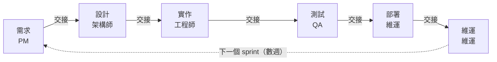

AI 在這裡只是**輔助工具**：補全程式碼、產生文件、寫幾個測試。流程本身沒有改變，每個階段之間的交接、會議與文件仍然由人負責。

#### 對照組：AWS AI-DLC（AI-Driven Development Lifecycle）

AWS 從另一個方向出發：**以開發速度為目標，重新設計整個生命週期**，把階段改成三個、步驟改成九個：

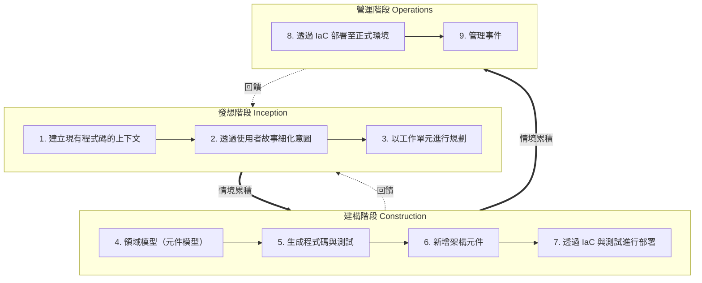

> **每個步驟都為下一步建立更豐富的情境。**
> 計畫、需求、設計等產物都存在專案 repo 裡，跨多次工作階段持續延用。

每一項活動都重複同一個循環：

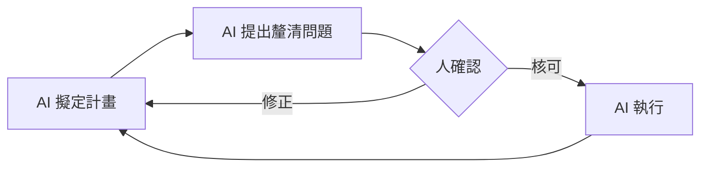

AI-DLC 也重新定義了儀式與名詞：Sprint 換成以小時或天計的 **Bolt**、Epic 換成 **Unit of Work**，團隊以 **Mob Elaboration / Mob Construction** 的方式一起即時確認 AI 的提案。

#### 我們的 AI-SDLC：把開發方法內建在流程裡

我們要解決的是**管理問題**：交談式、零散、沒有規範的開發方式，讓專案難以一致，也讓我們花大量時間教育與監督參與者。
所以我們沒有重新設計流程，而是**沿用團隊熟悉的 SDLC 階段與 GitHub 工作方式**，在每個階段放一個 AI hook，把該階段的開發方法與範本寫進 hook，並在階段之間保留人的確認：

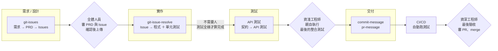

| 階段 | 誰負責確認 | 為什麼是他 |
|------|-----------|-----------|
| 需求 / 設計 | **全體人員**：專案人員、資深工程師、資淺工程師 | 需求是所有人的共識，一開始就一起定，後面才不會各自解讀 |
| 實作 | **不需要人** | 完成條件是測試全部通過，由 harness 迭代判斷，不靠人盯 |
| 測試 | **視情況而定**；最後的整合測試一定由**資淺工程師**親自執行 | 實際操作功能的人親手驗過，才真正掌握這個功能；同時也是最好的上手方式 |
| 交付 | 搭配 CI/CD（Continuous Integration / Continuous Delivery，持續整合與持續交付）自動跑測試，**資深工程師**做最後驗收 | 資深工程師的時間從逐行 review，集中到最後一道把關 |

每個階段被內建的開發方法：

| 階段 | 內建的方法與規範 | 參與者不用再被教的事 |
|------|---------------|-------------------|
| 需求 / 設計 | SDD：PRD 範本、EARS 句型、Issue 格式 | 需求怎麼寫、issue 怎麼拆、label 與 milestone 怎麼用 |
| 實作 | TDD + Harness：驗收條件變成完成條件，測試全綠才算完成 | 要不要寫測試、做到哪裡算完成 |
| 測試 | API Test First：依契約先寫 API 測試 | 要測哪些情境、錯誤碼要不要測 |
| 交付 | Conventional Commits、PR 範本、自動更新 README | commit 與 PR 格式、文件記得更新、PR 連到 issue |

每個階段的產物（PRD → GitHub Issue → API 契約 → 測試 → commit → PR）都存在 repo 或 GitHub 上，下一個階段的 hook 再把它收集起來交給 AI，**整條流程因此串在一起**。

#### 三者比較

| 面向 | 傳統 SDLC | AWS AI-DLC | 我們的 AI-SDLC |
|------|----------|-----------|---------------|
| **出發點** | — | **開發速度**：AI 是核心協作者，重新設計生命週期 | **專案管理**：確保一致性，省去教育與監督參與者 |
| 要解決的問題 | — | 既有流程的儀式與交接拖慢交付 | 交談式、零散、沒有規範的 AI 開發，讓專案品質不一 |
| 階段 | 需求 → 設計 → 實作 → 測試 → 部署 → 維運 | 發想 → 建構 → 營運（3 階段 9 步驟） | 需求 / 設計 → 實作 → 測試 → 交付（沿用 SDLC） |
| AI 的角色 | 補全、產生文件 | 擬計畫、提問、執行 | 照流程內建的方法與範本，產生 PRD、Issue、程式、測試、commit、PR |
| 開發方法放在哪裡 | 文件與教育訓練，靠人遵守 | 由團隊在 Mob 儀式中即時確認 | **寫進每個階段的 hook**：照流程走就是照規範做 |
| 誰做關鍵決策 | 人 | 人：AI 主動提問，關鍵決策交給人 | 人：需求由全體人員定、整合測試由資淺工程師驗、交付由資深工程師驗收 |
| 工作拆分 | Epic / Story | Unit of Work | GitHub Issue（＋ Label、Milestone） |
| 團隊協作 | 各自分工、靠會議交接 | Mob Elaboration / Mob Construction | 沿用 GitHub 流程：Issue、PR、CI/CD，資深工程師最後驗收 |
| 情境（context）放哪裡 | 散落在文件、會議、個人腦中 | AI 產生的計畫、需求、設計存進 repo | PRD、Issue、API 契約、測試存在 repo 與 GitHub；hook 每次自動收集 |
| 對參與者的要求 | 熟悉規範、自律遵守 | 團隊一起參與 Mob 儀式 | **會用流程即可**，規範由流程保證 |

#### 出發點不同，做法相近

AI-SDLC 是我們從管理需求自己發展出來的，設計時並沒有參考 AI-DLC。
但放在一起看，兩者有幾個相近的做法，而這些相近之處正好說明它們不是偶然：

| 相近的做法 | AWS AI-DLC | 我們的 AI-SDLC |
|-----------|-----------|---------------|
| AI 產出、人確認 | AI 擬計畫、提問，人核可後才執行 | 每個階段之間有固定的把關點 |
| 情境逐步累積 | 每個步驟為下一步建立更豐富的情境 | 每個階段的產物存在 repo / GitHub，下一個 hook 把它收集進 prompt |
| 先釐清意圖再實作 | 使用者故事 → 工作單元 → 程式 | 需求 → PRD → Issue → 契約 → 程式 |
| 產物存進專案 | 計畫、需求、設計存進 repo | PRD、Issue、契約、測試、文件都在 repo 與 GitHub |

不同的地方：AI-DLC 為了速度，改了流程、角色與儀式（Bolt、Mob）；AI-SDLC 為了一致性，**不改流程，只把方法內建進流程**。營運階段（IaC（Infrastructure as Code，基礎設施即程式碼）、正式部署、管理事件）也不在我們的範圍，交付停在 PR。

> **AI-DLC 為了速度重新設計流程；AI-SDLC 為了管理，把開發方法內建在現有流程裡。**
> 我們不是為了技術而技術，是為了讓專案在多人參與下仍然保持一致，而導入新技術。

> 參考：AWS DevOps Blog〈[AI-Driven Development Life Cycle: Reimagining Software Engineering](https://aws.amazon.com/blogs/devops/ai-driven-development-life-cycle/)〉；AI-DLC 階段與步驟圖出自 2026 亞馬遜港都 AI 創新日。

### 2.2 TDD / BDD / SDD：三種「先定義對，再寫程式」

三種方法都主張**先定義「什麼叫做對」，再寫程式**，差別在回答的問題、參與的人、以及規格的寫法。

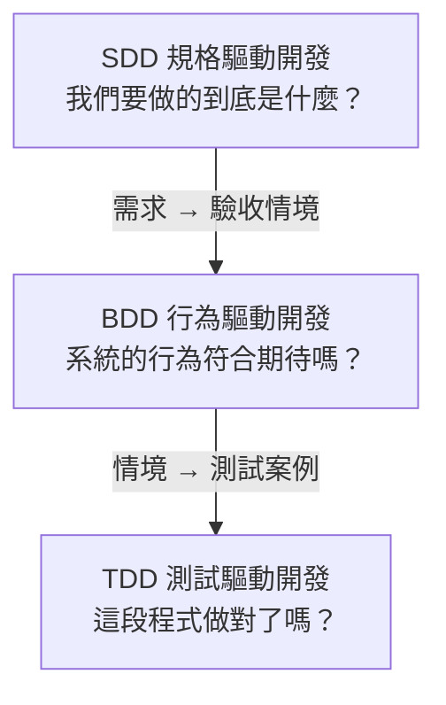

#### 三者比較

| 面向 | TDD 測試驅動開發 | BDD 行為驅動開發 | SDD 規格驅動開發 |
|------|----------------|----------------|----------------|
| 提出者 | Kent Beck（2002，《Test-Driven Development: By Example》） | Dan North（2006，〈Introducing BDD〉） | 沿自需求工程與 Design by Contract，AI 時代重新被強調（如 Kiro Spec、GitHub Spec Kit） |
| 回答的問題 | 這段程式做對了嗎？ | 系統的行為符合使用者期待嗎？ | 我們要做的到底是什麼？ |
| 主要參與者 | 開發者 | 開發、PM（Product Manager，產品經理）、QA（Quality Assurance，品質保證）一起討論（Three Amigos） | PM、架構師、開發者，以及 AI |
| 核心循環 | Red → Green → Refactor | 討論範例 → 寫成情境 → 自動化 | 需求 → 規格 → 設計 → 任務 → 實作 |
| 作用層級 | 任何層級；最常見於單元層，用在驗收層稱為 **ATDD**（Acceptance Test-Driven Development，驗收測試驅動開發） | 功能 / 驗收層 | 系統、功能、介面層 |
| 弱點 | 只證明「程式符合測試」，不證明「測試符合需求」 | 情境一多，維護成本高 | 規格本身不會執行，沒有轉成測試就沒有約束力 |

> TDD 不等於單元測試。TDD 是「先寫失敗的測試，再寫程式讓它通過」的**開發節奏**，可以用在任何層級；
> 常見的做法是**雙迴圈 TDD**：外圈用驗收測試定義功能，內圈用單元測試驅動實作。

#### 各自用哪些規格文件規範

| 方法 | 規範 | 說明 |
|------|------|------|
| **TDD** | **AAA**（Arrange-Act-Assert，Bill Wake） | 一個測試分三段：準備、執行、驗證 |
| | **Four-Phase Test**（Setup-Exercise-Verify-Teardown，Gerard Meszaros《xUnit Test Patterns》） | AAA 再加上清理階段 |
| | **Given-When-Then 命名** | 借用 BDD 的句型來命名或註解測試 |
| | **測試命名慣例** | 例如 `方法_情境_預期結果`（Roy Osherove）或 `should_…_when_…` |
| | **Test List**（Kent Beck） | 動手前先列出要寫的測試清單，一次處理一個 |
| | **ISO/IEC/IEEE 29119-3**（前身 IEEE 829） | 國際標準（ISO：International Organization for Standardization；IEC：International Electrotechnical Commission；IEEE：Institute of Electrical and Electronics Engineers）的正式測試案例規格文件：識別碼、前置條件、輸入、預期結果、後置條件 |
| **BDD** | **Gherkin**（`.feature` 檔） | `Feature` / `Scenario` / `Given` / `When` / `Then` / `And` / `But`，可直接自動化 |
| | **Specification by Example**（Gojko Adzic） | 用具體範例取代抽象描述，範例即規格 |
| | **Example Mapping**（Matt Wynne） | 用卡片把一個 Story 拆成規則、範例、待釐清問題 |
| **SDD** | **EARS**（Easy Approach to Requirements Syntax，Rolls-Royce） | 五種句型寫出無歧義、可測試的需求 |
| | **User Story + 驗收條件** | `As a … I want … so that …`（Connextra 格式），用 INVEST（Independent、Negotiable、Valuable、Estimable、Small、Testable）檢查品質 |
| | **PRD**（Product Requirement Document） | 產品層級：目標、使用者、範圍、功能、非功能需求、里程碑 |
| | **ISO/IEC/IEEE 29148**（前身 IEEE 830） | 正式的軟體需求規格書（SRS，Software Requirements Specification） |
| | **OpenAPI / AsyncAPI** | 介面層級：機器可讀的 API 契約 |
| | **ADR**（Architecture Decision Record） | 設計層級：記錄架構決策與理由 |

#### 同一條需求的三種寫法

以「登入失敗」為例：

**SDD（EARS）**：說清楚「要什麼」

```text
If 使用者連續輸入錯誤密碼 5 次, then the system shall 鎖定帳號 15 分鐘並通知使用者。
```

**BDD（Gherkin）**：說清楚「行為長什麼樣」

```gherkin
Feature: 帳號登入
  Scenario: 連續輸入錯誤密碼後鎖定帳號
    Given 使用者帳號已連續登入失敗 4 次
    When 使用者再次輸入錯誤密碼
    Then 帳號被鎖定 15 分鐘
    And 使用者收到帳號鎖定通知
```

**TDD（AAA 結構的測試）**：說清楚「程式怎樣算對」

```python
def test_login_locks_account_after_five_failures():
    # Arrange：帳號已失敗 4 次
    account = Account(failed_attempts=4)
    # Act：第 5 次輸入錯誤密碼
    result = login(account, password="wrong")
    # Assert：帳號被鎖定 15 分鐘
    assert result.locked is True
    assert result.locked_minutes == 15
```

EARS 的五種句型：

| EARS 類型 | 句型 | 例子 |
|------|------|------|
| Ubiquitous | The system shall … | 系統應以加密方式儲存密碼 |
| Event-driven | When [觸發], the system shall … | 當使用者登入成功時，系統應記錄登入時間 |
| Unwanted behavior | If [狀況], then the system shall … | 若連續輸入錯誤密碼 5 次，系統應鎖定帳號 |
| State-driven | While [狀態], the system shall … | 當帳號處於鎖定狀態時，系統應拒絕所有登入 |
| Optional | Where [功能啟用], the system shall … | 若啟用雙因素驗證，系統應要求輸入驗證碼 |

> **三者不是互相取代，而是一路推導**：SDD 定義要做什麼，BDD 把它寫成可驗收的情境，TDD 確保每一段程式都做對。
> 一條 EARS 需求、一個 Gherkin 情境、一個 AAA 測試，可以描述同一件事，只是精確度與受眾不同。

### 2.3 測試金字塔：測試要分層

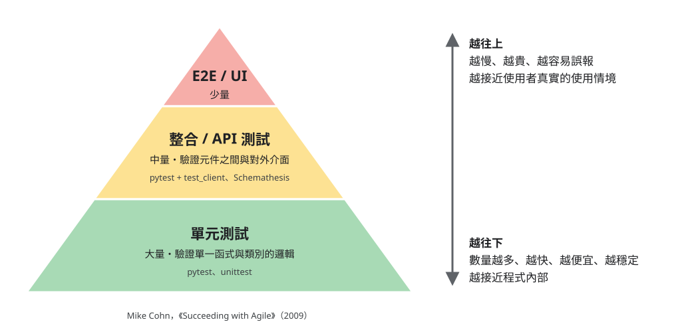

由 Mike Cohn 在《Succeeding with Agile》（2009）提出：**越往下越多、越快、越便宜；越往上越少、越慢、越接近真實使用情境。**

| 層級 | 驗證什麼 | 速度 / 成本 | 失敗時代表 | 常見工具（Python） |
|------|---------|-----------|----------|------------------|
| E2E（End-to-End，端到端）/ UI（User Interface，使用者介面） | 使用者從畫面操作到資料庫的完整流程 | 最慢、最貴、最容易誤報 | 使用者真的會遇到問題 | Playwright、Selenium |
| 整合 / API | 元件之間、對外介面（HTTP（HyperText Transfer Protocol，超文本傳輸協定）API）的行為 | 中等 | 介面或元件協作出錯 | pytest + Flask `test_client`、Schemathesis |
| 單元 | 單一函式、類別的邏輯 | 最快、最便宜 | 某段邏輯錯了 | pytest、unittest |

方法論和金字塔的對應：

| 方法 | 主要落在哪一層 |
|------|-------------|
| TDD | 單元層（內圈）；ATDD / 雙迴圈 TDD 的外圈在整合或驗收層 |
| BDD | 整合層或 E2E 層的驗收情境 |
| SDD | 不寫測試本身，但它的產物（EARS、OpenAPI）是**整合層與 E2E 層測試的來源** |

常見的反模式與變形：

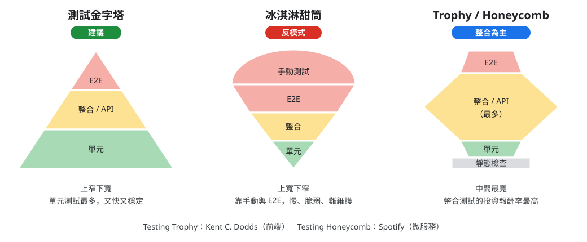

| 名稱 | 形狀 | 說明 |
|------|------|------|
| 冰淇淋甜筒（反模式） | 上大下小 | 大量手動與 E2E 測試、很少單元測試：慢、脆弱、難維護 |
| Testing Trophy（Kent C. Dodds） | 中間最胖 | 前端社群的主張：整合測試的投資報酬率最高 |
| Testing Honeycomb（Spotify） | 中間最胖 | 微服務的主張：服務之間的整合比服務內部細節更重要 |

> 金字塔的重點不是固定的比例，而是**每一層都要有，而且要知道每一層在保護什麼**。

### 2.4 API Test First：為什麼要先寫中間那一層

回到 2.2 的弱點與 2.3 的金字塔：

- **TDD 的弱點**：只證明「程式符合測試」。當同一個人（或同一個 AI）同時寫實作和單元測試，測試很容易遷就實作，等於**自己出題自己考**。
- **SDD 的弱點**：規格不會執行。API 契約寫得再漂亮，沒有測試去比對，實作偏掉了也沒人知道。

**API Test First 就是把這兩個弱點接起來的那一層**：在金字塔的中間層，測試**從 API 契約（SDD 的產物）推導**，不從實作推導，並且用 TDD 的節奏在實作之前先寫好。

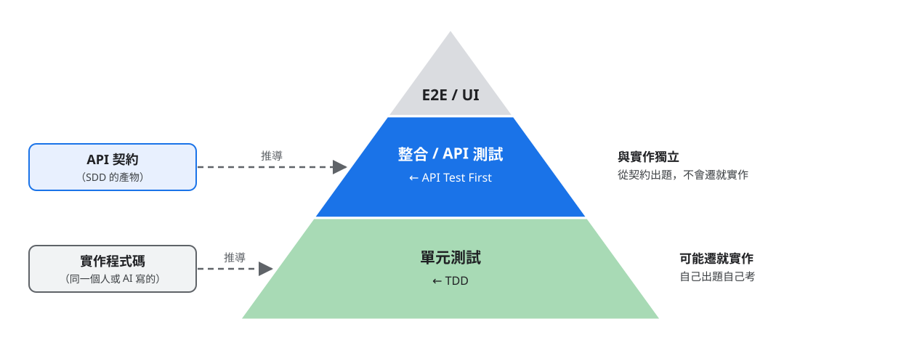

#### 為什麼要 API Test First

1. **測試與實作獨立**：從契約推導，不是從實作推導，避免自己出題自己考。
2. **讓規格有約束力**：把 API 契約變成可執行的檢查，SDD 的規格才真的「管得住」程式。
3. **BDD 情境在後端最自然的落點**：Given / When / Then 剛好對應「準備資料 / 送出 request / 驗證 response」。
4. **最穩定的護欄**：內部怎麼重構、AI 怎麼重寫，只要契約不變，API 測試就不用改。
5. **人看得懂**：request / response 比滿是 mock 的單元測試容易審查，PM 與使用者也能確認行為，這是**人掌握整個功能的抓手**。
6. **成本甜蜜點**：比 E2E 快又穩定，又比單元測試更接近使用者真正會遇到的行為（呼應 Testing Trophy 與 Honeycomb）。
7. **前後端可以平行開發**：契約與測試先定好，前端照契約做 mock，後端照測試實作。

#### API-First：先有契約，才有 API Test First

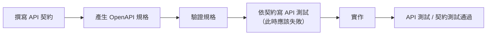

| | API-First | API Test First |
|---|-----------|---------------|
| 先做什麼 | 先寫 API 契約，再寫實作 | 先依契約寫 API 測試，再寫實作 |
| 產出 | API 契約 → OpenAPI | API 測試 ＋ 契約測試 |
| 好處 | 前後端可平行開發 | 實作時有明確、可執行、與實作獨立的目標 |

兩條原則：

- **只改來源，不改生成物**：契約是來源，OpenAPI 與合併後的文件由工具產生，不手改。
- **API model ≠ DB（Database，資料庫）schema**：回應形狀以 API 契約為準，不拿資料表欄位當 API 規格。

### 2.5 Harness Engineering：讓 AI 自己修到過

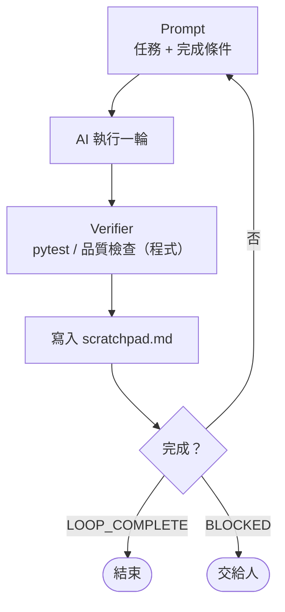

| 元素 | 作用 |
|------|------|
| Prompt | 任務與完成條件 |
| Verifier | 客觀判斷，**是程式不是 AI**，AI 不能改門檻 |
| Memory | `scratchpad.md` 跨輪保存進度 |

> 今天的主角是**單次執行**的 runner；需要迭代的任務會在 prompt 裡讓 AI 去啟動 harness 迴圈。
> **Runner 負責「組好一次執行」，harness 負責「重複執行直到通過」。**

---

## 3. 拆解：每個 SDLC 階段的 hook 需要哪些材料

在看 runner 怎麼寫之前，先拆開來看：**每個階段要交給 AI 哪些材料，AI 才能做對？**

### 3.1 材料的分類：五個元件

runner 把一次 AI 執行需要的東西分成五類：

```
┌──────────────────────────────────────────────┐
│ agent    誰在做、有什麼權限        ← 指令旗標  │
│ model    用多聰明的腦             ← 指令旗標  │
├──────────────────────────────────────────────┤
│ steering 遵守什麼規範             ← prompt 最前 │
│ prompt   做什麼任務              ← prompt 中間 │
│ context  看到什麼現況資料         ← prompt 最後 │
└──────────────────────────────────────────────┘
```

**runner 為五個元件都留了位置，目前實際用到的是 model、steering、prompt、context 四個：**

| 元件 | 來源 | 目前的實際使用情況 |
|------|------|------------------|
| agent | JSON（JavaScript Object Notation）設定的 `agent` / `--agent` | **尚未使用**：所有 hook 都留空，用 kiro-cli 預設 agent |
| model | JSON `model` / `--model` | ✅ 簡單任務（commit、PR、翻譯）用 haiku，需求分析與實作交給 auto |
| steering | JSON `steering` 指向專案規範 `.md` | ✅ `git-issue-resolve` 注入 `.kiro/steering/api-first-workflow.md`（專案依 README「安裝設定」第 5 步建立） |
| prompt | `<name>.prompt.md` | ✅ 每個 hook 都有 |
| context | `<name>.context.sh` 的輸出 | ✅ 需要現況資料的 hook 都有 |

> 那專案規範怎麼給 AI？目前是**寫在 prompt 裡，要求 AI 自己去讀**：「必須先讀取 `agent.md`」、「依照某某範本」。
> 這樣做簡單，但 AI 有沒有真的讀、讀了多少，要看 AI 自己；steering 則是 runner 直接把內容放進 prompt，保證一定看得到。
> 規範變多、需要強制時，就是把它們從「prompt 裡的指示」搬到 steering 的時候。

整條流程串起來：

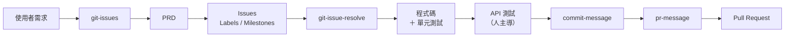

### 3.2 需求 / 設計：`git-issues`

**目標**：把使用者的一段口語需求，變成 PRD，再拆成可以上傳 GitHub 的 Issues、Labels、Milestones。

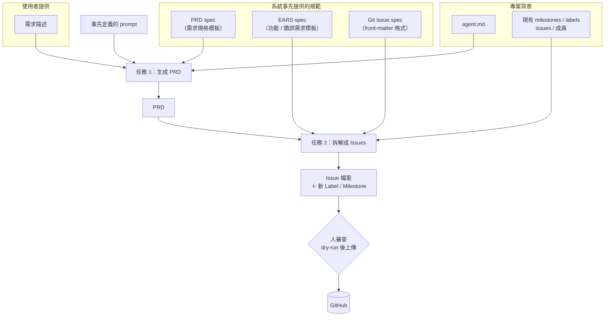

| 材料 | 誰提供 | 怎麼給 AI | 內容 |
|------|-------|----------|------|
| 需求描述 | **使用者** | AI 依 prompt 指示讀取 | 用範本寫的口語需求：角色、目的、具體需求、驗收條件、限制 |
| **PRD spec** | 系統事先提供 | prompt 指定範本 | PRD 的 10 節格式：專案概述、系統流程（Mermaid，處理區塊標 F-XX）、功能需求（User Story 對應 F-XX）、畫面規格、API 規格、基礎建設、非功能需求、Milestone 規劃、待確認事項、修訂紀錄 |
| **EARS spec** | 系統事先提供 | prompt 指定範本 | Issue 內文用的 EARS 五種句型、API 端點、驗收條件、測試資料需求、優先級（功能需求與錯誤回報各一份） |
| **Git Issue spec** | 系統事先提供 | prompt 指定範本 | YAML（YAML Ain't Markup Language）front-matter（`title` / `labels` / `milestone` / `assignees`）、標題格式 `[FEATURE] 功能 — 類型（說明）`、「建議新增 Label」區塊 |
| `agent.md` | 專案維護 | prompt 要求先讀 | 專案定位、技術棧、分層、絕對不能踩的雷 |
| GitHub 設定快照 | context script 自動建立 | prompt 要求參考 | 現有 milestones、labels、issues、成員（避免重複、沿用既有命名） |
| 事先定義的 prompt | 系統事先提供 | **prompt 本體** | 兩個任務的步驟、**輸出目錄規範**（只能寫 `temp/`）、拆解原則、Label / Milestone 規範 |

**產出**

| 產出 | 用途 |
|------|------|
| PRD | 需求的單一事實來源（SDD），之後的 issue 與 API 契約都由它推導 |
| Issue 檔案（每個工作單元一個） | 一個 Issue 就是一個工作單元（類似 AI-DLC 的 Unit of Work） |
| 新的 Label / Milestone | 寫回設定檔，上傳時一併建立 |

> **人的把關點（全體人員）**：AI 只把檔案寫到 `temp/`，**不直接建立 GitHub issue**。專案人員、資深工程師、資淺工程師一起看過 PRD 與 Issue，用 dry-run 確認上傳計畫後，才執行上傳。

### 3.3 實作：`git-issue-resolve`

**目標**：拿一個（或多個）GitHub issue，切分支、轉成 harness 任務，迭代到驗收條件全部通過。

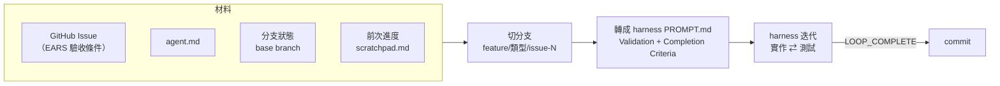

| 材料 | 怎麼給 AI | 內容 | 為什麼需要 |
|------|----------|------|-----------|
| GitHub issue 內容 | **context**（context script 用 `gh` 下載） | 標題、內文、labels、milestone | 任務本身；EARS 驗收條件會變成 Completion Criteria |
| 目前分支、base branch、分支是否已存在 | **context** | git 狀態 | 決定要新建還是延續分支 |
| 前次進度 `scratchpad.md` | **context** | 上一次做到哪 | 中斷後可以接續，不重做 |
| `agent.md` | prompt 要求 harness 參考 | 專案背景、分層規則、禁忌 | 讓 AI 照專案的架構寫，不自創 |
| API-First 規範 | **steering**（`.kiro/steering/api-first-workflow.md`） | 契約先行、只改來源不改生成物 | 實作時守住 API 契約 |
| 事先定義的 prompt | **prompt** | 切分支 → 建 PROMPT.md → 啟動 harness → commit；**禁止**長時間程序、背景執行、部署 | 把流程與禁止事項固定下來 |

> **單元測試在這一步就完成**：harness 的完成條件包含測試全綠，AI 在實作時會一併寫單元測試（TDD）。
> **這一步不需要人**：做到哪裡算完成由測試判斷，不靠人盯進度。

### 3.4 測試：API 測試由人主導

單元測試在實作中已經完成，但 **API 測試（整合測試）要由人主導**，原因就是 2.4 講的：

- 單元測試是 AI 寫實作時一併產生的，**可能遷就實作**。
- API 測試從契約推導，是**人確認「這個功能真的是我要的」的地方**：看得懂 request / response，就掌握了整個功能的行為。

中間的測試要不要人介入，**視情況而定**；但**最後的整合測試一定由資淺工程師親自執行**：

- 實際操作這個功能的人親手驗過，才真正掌握它，之後維護、除錯都靠這份理解。
- 對資淺工程師來說，這也是最好的上手方式：不必先讀完所有程式，從 request / response 就能理解功能的全貌。

| 材料 | 內容 | 誰負責 |
|------|------|-------|
| API 契約 | 端點、request / response、錯誤碼 | 需求階段由全體人員確認 |
| OpenAPI（由契約生成） | 機器可讀的規格 | 工具產生 |
| 測試 fixtures | 可用的測試工具與鑑權方式 | 專案既有 |
| Flask 實際註冊的路由 | 哪些端點已經實作，並與 OpenAPI 比對 | flask-he 收集 |
| 測試情境 | 每個端點：成功情境 ＋ 契約宣告的每一種錯誤 | **AI 產生** |
| 最後的整合測試 | 實際執行、判斷結果對不對 | **資淺工程師** |

> AI 可以幫忙產生 API 測試（實戰流程步驟 8 的 flask-he），但**最後執行整合測試、判斷結果對不對的是資淺工程師**。

### 3.5 交付：`commit-message` / `pr-message`

交付的 hook 不只是「寫一段訊息」，還會**順手處理那些人常常忘記的事**：

| Hook | 主要工作 | 預設順手處理的事 |
|------|---------|----------------|
| `commit-message` | 分析 diff，產生 Conventional Commits 格式的訊息 | ・**自動更新變更目錄下的 `README.md`**：程式改了，說明文件跟著改，一併納入這次 commit<br/>・判斷變更性質（feat / fix / docs…）與影響範圍<br/>・依模式支援父專案、submodule、獨立工具 repo |
| `pr-message` | 依 PR 模板產生描述並建立 PR | ・**從分支名稱抽出 issue 編號**，自動寫上 `Closes #N`，merge 後自動關閉 issue<br/>・依變更目錄自動分類（後端、前端、文件、測試…）<br/>・**自動判斷並套用 labels**，GitHub 上沒有的 label 會先建立<br/>・PR 描述存檔，建立後切回 base branch |

| 材料 | 怎麼給 AI | 內容 |
|------|----------|------|
| git 狀態與 diff | **context** | 分支、變更清單、diff 內容（裁切到固定行數） |
| 分支差異（PR） | **context** | base branch、分歧點之後的 commits 與檔案 |
| PR 模板 | prompt 指定範本 | 摘要、變更分類、相關 Issue、測試方式 |
| 現有 labels | prompt 要求參考 | 判斷要用哪些 label、哪些要新建 |
| 事先定義的 prompt | **prompt** | Conventional Commits 格式、README 更新規則、**禁止代替使用者確認提交** |
| 模型 | **model** | haiku：產生文字的任務不需要最強的模型 |

> **自動完成 documentation**：文件更新被綁進 commit 流程，就不會再有「程式改了、README 沒改」的情況。
> **人的把關點**：commit-message 是否直接 commit / push，取決於工作區的 git 權限；沒有權限時只準備好訊息，由開發者在終端機按下確認（收尾段會詳談）。
> PR 建立後搭配 CI/CD 自動跑測試，**資深工程師做最後驗收**後才 merge。資深工程師的時間因此從逐行 review，集中到最後一道把關。

### 3.6 總整理：同一支 runner，不同 hook

| SDLC 階段 | Hook | 方法論 | 系統事先提供 | 每次收集的 context | model | 誰負責確認 |
|-----------|------|-------|------------|------------------|-------|-----------|
| 需求 / 設計 | `git-issues` | SDD（PRD、EARS） | PRD spec、EARS spec、Issue spec、prompt | GitHub 設定快照（不存在時自動建立） | auto | **全體人員**：審 PRD 與 Issue，dry-run 後上傳 |
| 實作 | `git-issue-resolve` | TDD + Harness | prompt | issue、分支、前次進度 | auto | **不需要人**：測試全綠才算完成 |
| 測試 | flask-he（`run.sh`） | API Test First ＋ Harness | flask-he 設定檔、PROMPT 範本 | OpenAPI、Flask 路由、既有測試 | 依設定檔 | 視情況而定；**資淺工程師**執行最後的整合測試 |
| 交付 | `commit-message` | Conventional Commits | prompt | git status / diff | haiku | 有 git 權限時直接提交；否則開發者按 y 確認 |
| 交付 | `pr-message` | PR 模板 | PR 模板、prompt | 分支差異 | haiku | CI/CD 自動跑測試，**資深工程師**最後驗收、merge |

> **Runner 是穩定的引擎，Hook 是可替換的任務。**
> 上面每一列都是同一支 runner 在跑，差別只在三個檔案：`<name>.json`、`<name>.prompt.md`、`<name>.context.sh`。
> 目前用上 steering 的是 `git-issue-resolve`：專案的 API-First 規範每次都會被注入 prompt。

---

## 4. Runner 的設計：一支通用 hook runner 的關鍵決策

第 3 節的每個 hook 需要的材料都不同，但**組裝方式一樣**，所以由同一支 runner 負責。這一節從最陽春的一行指令出發，每遇到一個痛點就做一個設計決策，看 runner 怎麼一步步長成現在的樣子。

每個 hook 由三個檔案組成，runner 只負責把它們組裝成一次 AI 執行：

| 檔案 | 內容 |
|------|------|
| `<name>.json` | metadata：名稱、說明、agent、model、steering |
| `<name>.prompt.md` | 任務：做什麼、不准做什麼、怎樣算完成 |
| `<name>.context.sh`（可選） | 現況：每次執行時收集的資料 |

### 4.1 起點：一行指令

```bash
kiro-cli chat --no-interactive --trust-all-tools "$(cat tasks/hello.prompt.md)"
```

| 旗標 | 作用 | 設計考量 |
|------|------|---------|
| `--no-interactive` | 跑完就結束 | 才能被腳本、CI（Continuous Integration，持續整合）呼叫 |
| `--trust-all-tools` | AI 用工具不逐一詢問 | 權限很大，收尾時討論邊界 |

**這一行還缺什麼？**

| # | 問題 | 對應的設計 |
|---|------|-----------|
| 1 | 任務寫死，換任務要改腳本；不知道有哪些任務 | 4.2 任務註冊表 |
| 2 | 每個任務要不同的 model / agent | 4.3 Metadata 與設定優先序 |
| 3 | AI 看不到現況 | 4.4 Context Script 介面 |
| 4 | 規範要每次重貼；不知道 AI 實際收到什麼 | 4.5 Steering、組裝順序、dry-run |
| 5 | 換個目錄執行就壞；被 `source` 或掛進別的專案會出問題 | 4.6 可攜性與安全 |

> **設計原則 1**：runner 的輸出是「一個指令＋一份 prompt」，所以它可以在**完全不呼叫 AI** 的情況下被測試。

### 4.2 任務註冊表（Convention over Configuration）

```
tasks/
├── hello.prompt.md         ← 檔案存在 = 一個 hook
└── git-summary.prompt.md
```

CLI（Command-Line Interface，命令列介面）：`runner <hook-name> [args...]`、`--list`、`--help`

| 設計決策 | 理由 | 放棄的選項 |
|---------|------|-----------|
| 檔案存在即註冊 | 新增任務 = 新增檔案，runner 不用改 | 維護一份 registry 清單（容易和檔案不同步） |
| 用腳本自己的位置找 `tasks/` | 從任何目錄執行都找得到 | 用目前目錄（換目錄就壞） |
| hook 名稱後的非 `-` 參數收成 `HOOK_ARGS` | runner 不需要懂每個 hook 的參數，原樣轉交 | 每個 hook 自訂旗標（runner 越來越肥） |
| hook 名稱白名單 | 名稱會拼進檔案路徑，要擋 `../` | 不檢查 |

`HOOK_ARGS` 的真實用法：`commit-message ai-dev-tools`、`git-issue-resolve 42 43`、`pr-message demo/run-1`。runner 完全不知道這些參數是什麼意思，只負責轉交，由 hook 自己解讀。

### 4.3 Metadata 與設定優先序

**痛點**：`commit-message` 用便宜的 haiku 就夠了，`git-issue-resolve` 需要最強的模型。

```json
{
  "name": "AI Commit Message",
  "description": "分析 git 變更並生成 Conventional Commits 格式的 commit message",
  "agent": "",
  "model": "claude-haiku-4.5",
  "steering": []
}
```

**優先序：CLI 旗標 > JSON > 工具預設**

| 設計決策 | 理由 |
|---------|------|
| metadata 放 JSON、prompt 放 `.md` | 長 prompt 放進 JSON 會變成 `\n` 地獄，難編輯、diff 難讀 |
| 優先序 CLI > JSON > 預設 | 越靠近「這一次執行」的設定越優先，方便臨時覆蓋 |
| 用 python3 解析 JSON | macOS 預設沒有 jq；Flask 專案一定有 Python |
| 檔名當參數傳給解析程式 | 不把路徑拼進程式碼，避免注入 |
| 指令用陣列組成 | 避免值含空白時被拆成多個參數 |
| 旗標缺值要明確報錯 | 例如 `--model` 後面沒給值；不檢查的話參數解析會停在同一個旗標，形成無限迴圈 |

### 4.4 Context Script 介面

**痛點**：寫 commit message 要手動貼 diff、解 issue 要手動貼 issue。

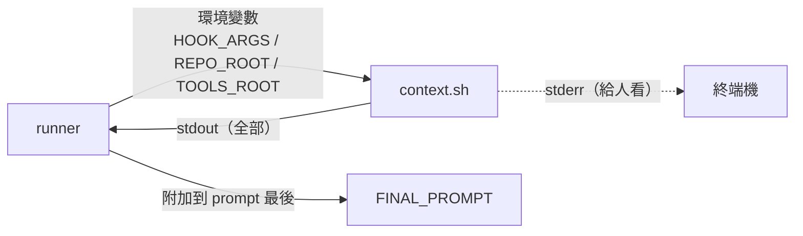

| 方向 | 選擇 | 理由 |
|------|------|------|
| runner → script | 環境變數 | 不必約定參數順序；用不到的就忽略；任何語言都讀得到 |
| script → runner | stdout 全部內容 | 最簡單的介面；script 可以用任何工具產生 |
| 失敗 | 非 0 exit → 附上 `(context collection failed)`，不中斷 | AI 與人都看得到；script 可先印 `ERROR:` 說明原因 |
| 執行位置 | 固定在專案根目錄執行 | 從子目錄執行，結果一致 |
| 必要性 | 可選 | 很多 hook 不需要現況資料（例如翻譯） |

重要的區分：**`REPO_ROOT`（使用者的專案）≠ `TOOLS_ROOT`（工具所在）**。

- context script 用 `=== SECTION ===` 分段，prompt 就能用名稱引用（「請看上下文中的 ISSUE_JSON」）。**prompt 與 context script 之間也有介面**，改名要兩邊一起改。
- 資料量在 script 裡裁切，runner 不管內容。
- stdout 是資料（會進 prompt），stderr 是給人看的訊息。

實戰中看得到的例子：`git-issue-resolve` 的 context 收集 Issue 內容、分支狀態與前次進度；`git-issues` 的 context 在 GitHub 設定快照不存在時自動建立它（見實戰流程步驟 2）。

### 4.5 Steering、組裝順序、dry-run

**痛點 1**：同一份團隊規範要寫進 N 個 prompt。
**痛點 2**：prompt 越組越複雜，不知道 AI 實際收到什麼；每次試都花錢花時間。

```
┌─ ## 規範（Steering）        ← 最穩定、最高層的約束
├─ <prompt.md 內容>            ← 任務
├─ ## 上下文資訊               ← 最易變、量最大的資料
└─ ## 工具路徑資訊（nested 時）
```

| 設計決策 | 理由 |
|---------|------|
| steering 路徑**相對 `REPO_ROOT`** | 規範屬於專案，不屬於工具；同一個 hook 在不同專案讀到各自的規範 |
| 找不到 steering 檔只警告 | 缺規範不該讓任務失敗，但要讓人知道 |
| 指令在前、資料在後 | AI 先知道規則與任務，再讀資料，比較不會被大量資料帶偏 |
| 資料加標題、放最後 | diff / issue 可能含「看起來像指令」的文字（prompt injection），明確標示可降低風險，但不能完全消除 |
| `--dry-run` | prompt 的除錯器、也是 code review 工具；不呼叫 AI、不動 git |

實例：`git-issue-resolve.json` 的 steering 指向 `.kiro/steering/api-first-workflow.md`。專案沒有這個檔時，dry-run 會出現 `Warning: Steering file not found`，這正是 dry-run 的價值。

### 4.6 可攜性與安全

**痛點 1**：有人用 `source` 執行，`exit` 把整個終端機關掉。
**痛點 2**：工具要給很多專案用，prompt 裡寫「參考 `harness-engineering/README.md`」，AI 在專案根目錄找不到。
**痛點 3**：AI 執行失敗，runner 還是回傳成功，CI 以為沒問題。

```
my-flask-project/          ← REPO_ROOT（steering、context、AI 的工作目錄）
├── backend/
├── docs/api/
└── ai-dev-tools/          ← TOOLS_ROOT（runner、tasks、範本）
    └── scripts/hooks/kiro-hook-run.sh
```

| 設計決策 | 理由 |
|---------|------|
| 整支包進函式，內部用 `local` 與 `return` | `bash` 執行和 `source` 都安全 |
| `TOOLS_ROOT ≠ REPO_ROOT` 時進入 Nested mode，在 prompt 尾端注入工具路徑資訊 | AI 知道工具內的檔案要加 `TOOLS_REL_PATH` 前綴 |
| 一律使用實體路徑 | `git rev-parse` 回傳實體路徑；macOS 的 `/tmp` 是連結，不統一就比對失敗 |
| 回傳 AI 工具的 exit code | 讓 CI 或上層腳本能判斷失敗 |

本 repo 就是 Nested mode：工具集 `ai-dev-tools/` 放在專案根目錄下、被 `.gitignore` 排除，所以實戰中所有範本路徑都寫成「本工具集中的 …」，由 runner 補上前綴。

---

## 5. 實戰流程：一輪完整的 AI-SDLC 示範

> 題材：會議記錄彙整系統：上傳會議逐字稿 → Bedrock（Claude）彙整摘要與與會者 → SES 寄信通知
> 所有指令都在 **repo 根目錄**執行，並已 `source .venv/bin/activate`
> 範例中的檔名、Issue 編號、分支名稱都來自 2026-11-10 實際跑過的一輪

這一節把前面的觀念與工具串成一次真實的操作：用 git 分支管理整場展示，讓 LLM 依 Issue 編碼，用 harness engineering 生成單元與整合測試，再用 OpenTelemetry 觀察每個請求的呼叫鏈。

### 全貌

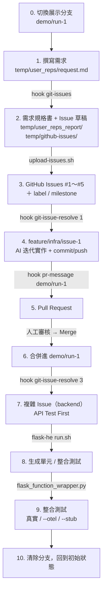

| 步驟 | 指令 | 輸入 | 使用的範本 | 產出 | 人要確認什麼 |
|------|------|------|-----------|------|-------------|
| 0 | `git checkout -b demo/run-1 demo-baseline` | 基準 tag | — | 展示分支 | 起點是乾淨的基準 |
| 1 | （手寫） | 口語需求 | `user_request_template.md`（參考用） | `temp/user_reps/request.md` | 需求寫清楚、只放這一輪的需求 |
| 2 | `hook git-issues` | `temp/user_reps/*.md`、`agent.md`、GitHub 設定快照 | `user_requirement.md`、`feature_request_ears.md` | 規格書、Issue 草稿 | 第 9 節待確認事項、Issue 拆分、label、milestone |
| 3 | `upload-issues.sh` | `temp/github-issues/*.md` | — | GitHub Issues、label、milestone | dry-run 清單 |
| 4 | `hook git-issue-resolve 1` | GitHub Issue #1 | 內建 PROMPT 格式、steering | feature 分支、commit | diff、測試結果 |
| 5 | `hook pr-message demo/run-1` | 分支差異 | `pull_request_template.md` | PR | **base 是 `demo/run-1`** |
| 6 | （GitHub 網頁） | PR | — | 合併 commit | Approve 不等於 Merge |
| 7 | `hook git-issue-resolve 3` | Issue #3 | steering `api-first-workflow.md` | 程式、端點文件、測試 | API 契約與實作一致 |
| 8 | `flask-he/run.sh` | `flask-he-config.yaml`、openapi | flask-he PROMPT 範本 | `backend/tests/unit/`、`integration/` | 測試品質、覆蓋率 |
| 9 | `flask_function_wrapper.py` | 請求檔 `requests/*.json` | — | 測試結果、trace | **真實呼叫是否正常** |
| 10 | `git checkout develop` … | — | — | 乾淨的工作環境 | 不要誤刪要保留的紀錄 |

---

### 步驟 0：切換展示分支

```bash
git fetch --tags
git checkout -b demo/run-1 demo-baseline
git push -u origin demo/run-1
```

- `demo-baseline` 是事先打好的基準 tag（做法見 [README](../../README.md) 第 9 步）。每次展示都從它開一條新分支，`develop` 保持乾淨。
- 之後所有 PR 都合併進 `demo/run-1`，**不要合進 `develop`**。
- `git-issue-resolve` 會從「目前分支的最新 commit」切出 feature 分支，所以開始實作前一定要先在 `demo/run-1` 上。

---

### 步驟 1：撰寫需求：`temp/user_reps/request.md`

用口語寫就好，不需要寫成規格。本次範例的需求包含：

- 上傳會議記錄，用 Claude 彙整（附上完整的彙整提示詞）
- `POST /api/meeting-minute`：傳入檔案，回傳會議摘要與與會者（姓名、Email）
- `POST /api/notify`：傳入摘要與與會者，用 AWS SES（`ap-southeast-1`）寄信
- 「本機有設定好的 AWS profile，不用考慮權限問題」

#### 範本

`ai-dev-tools/scripts/hooks/template/user_request_template.md` 是給**人**參考的需求骨架（需求概述、需求陳述、具體需求、非功能需求、API 端點、驗收條件、限制條件）。**Hook 不會讀它**，用不用都可以。

#### 要注意

- `git-issues` 會讀 `temp/user_reps/` 底下**所有** `.md`，不是只讀最新的一份。換題材時，只留這一輪的需求檔。
- 整個 `temp/` 被 `.gitignore` 排除，需求檔不進版控。要重複使用的需求，請另外備份。
- 寫得越具體，拆出來的 Issue 越準。本次需求寫了「Claude Sonnet 4.0」，這個模型後來已下架，步驟 9 會看到它造成的問題。

---

### 步驟 2：生成規格書並切割 Issue：`hook git-issues`

```bash
hook git-issues --dry-run | less     # 先看 AI 會收到什麼（不呼叫 AI、不動 git）
hook git-issues                      # 實際執行
```

#### 2.1 Runner 做了什麼

| 元件 | 本 Hook 的設定 |
|------|---------------|
| metadata | `scripts/hooks/tasks/git-issues.json`：model 未指定（auto），沒有 steering |
| prompt | `scripts/hooks/tasks/git-issues.prompt.md` |
| context | `scripts/hooks/tasks/git-issues.context.sh`：檢查 GitHub 設定快照 `ai-dev-tools/gh-issue/config/` |

context script 會先確認快照存在。全新環境沒有快照時，它會自動呼叫 `fetch-config.sh`，用 `gh api` **唯讀**取得 repo 現有的 label、milestone、issue，寫進本機快照（被 gitignore）。上下文會附上 `=== GH_CONFIG ===` 區塊，告訴 AI 目前有幾個 label、幾個 milestone。

> 這也代表 `--dry-run` 第一次執行時，可能會唯讀呼叫 GitHub 並寫入本機快照。

#### 2.2 前置作業：清除舊產出

AI 會先刪掉 `temp/github-issues/*.md` 與 `temp/user_reps_report/*.md`，避免和上一輪的結果混在一起。不需要手動清理。

#### 2.3 任務 1：需求 → 需求規格書

| | 內容 |
|---|---|
| 輸入 | `temp/user_reps/request.md` |
| 先讀 | `agent.md`（技術棧、目錄結構、規則）、`ai-dev-tools/gh-issue/config/*.json`（成員、label、milestone、issue） |
| 範本 | `ai-dev-tools/scripts/hooks/template/user_requirement.md` |
| 輸出 | `temp/user_reps_report/system_requirement_2026-11-10.md`（檔名用執行當天的日期） |

`user_requirement.md` 規定規格書的 10 個章節：

| 節 | 內容 | 本次範例 |
|----|------|---------|
| 1 | 專案概述（背景、目標使用者、範圍、技術約束） | 技術約束取自 `agent.md` |
| 2 | 系統流程：2.1 主流程總覽圖（Mermaid，每個 Epic 一個 subgraph），2.2 起每個 Epic 一張細部流程圖，每個處理區塊標 `F-XX` | Epic 1 會議彙整（F-01～F-05）、Epic 2 寄送通知（F-06～F-09） |
| 3 | 功能需求，每個模組對應第 2 節的 `F-XX` | 3.1 上傳頁面 → F-01、F-05；3.3 LLM 服務 → F-03 |
| 4 | 畫面規格（wireframe 截圖） | 見下方說明 |
| 5 | API 規格 | `/api/meeting-minute`、`/api/notify` |
| 6 | 基礎建設 | Bedrock、SES |
| 7 | 非功能需求 | |
| 8 | **Milestone 規劃** | Phase A 基礎建設與 API 規格、Phase B 後端服務、Phase C 前端 |
| 9 | **待確認事項** | 模型 ID、Email 來源、SES sandbox…（見本步驟 2.5） |
| 10 | 修訂紀錄 | |

> 第 4 節的 wireframe 需要 chrome devtools MCP 截圖。環境沒有這個 MCP 時，AI 只會留下圖片佔位，本次範例就是如此。

#### 2.4 任務 2：規格書 → Issue 草稿

| | 內容 |
|---|---|
| 輸入 | 任務 1 產生的規格書 |
| 範本 | `ai-dev-tools/scripts/hooks/template/feature_request_ears.md` |
| 輸出 | `temp/github-issues/NN-<名稱>.md`，一個任務一個檔 |

每個 Issue 檔的開頭是 front matter，`upload-issues.sh` 會讀它：

```markdown
---
title: "[FEATURE] 會議彙整 — Backend（/api/meeting-minute 與 LLM 服務）"
labels: ["enhancement", "backend"]
milestone: "Phase B: 會議記錄系統 後端服務"
---
```

本文依 `feature_request_ears.md` 的章節：需求概述、**EARS 需求規格**、API 端點、驗收條件、測試資料需求、優先級、附加資訊。EARS 句型讓每條需求都能被測試：

| 類型 | 句型 | 本次範例（Issue #3） |
|------|------|---------------------|
| Event-driven | When [觸發], the system shall … | When 收到 POST /api/meeting-minute 且含 `file`，the system shall 呼叫 LLM 模組 |
| Unwanted behavior | If [條件], then the system shall … | If 副檔名非 .txt/.md、檔名無 YYYYMMDD，then the system shall 回 400 |
| Ubiquitous | The system shall … | The system shall 不在 log 記錄檔案內容與 email |

#### 拆解規則

- 依影響範圍拆，不強制每次都有 backend / frontend / infra。工作量極少的可以併到相關任務。
- 標題格式：`[FEATURE] {功能名稱} — {任務類型}（{簡短說明}）`

#### Milestone 規則

- 依規格書**第 8 節**決定，不沿用 repo 現有的 milestone。
- 不存在的 milestone，AI 會加進本機快照 `gh-issue/config/milestones.json`（不設 number、state 為 open），上傳時才在 GitHub 建立。

#### Label 規則

- Issue 的 `labels` 只能用快照 `labels.json` 裡**已存在**的 label。
- 現有 label 不夠時，在 Issue 檔末尾加「## 建議新增 Label」區塊。建議用 JSON 物件格式，一行一個：

```markdown
## 建議新增 Label
{"name": "backend", "color": "#1d76db", "description": "後端（Flask）相關"}
```

> 「建議新增 Label」也可以寫成 Markdown 列表，但目前 `scan_suggested_labels.py` 解析列表格式有 bug，抓不到 label。用 JSON 格式最保險。

#### 本次產出

| 檔案 | 上傳後 | labels | milestone |
|------|:------:|--------|-----------|
| `01-infra-config.md` | #1 | enhancement, infrastructure | Phase A |
| `02-api-docs.md` | #2 | enhancement, documentation | Phase A |
| `03-backend-meeting-minute.md` | #3 | enhancement, backend | Phase B |
| `04-backend-notify.md` | #4 | enhancement, backend | Phase B |
| `05-frontend-page.md` | #5 | enhancement, frontend | Phase C |

#### 2.5 人要確認的地方

1. **規格書第 9 節「待確認事項」**。本次第 1 項就問了「Bedrock 模型 ID 與 region？」，正是後來真實執行出問題的地方（模型已下架）。在這一步就確認，可以省下後面的除錯時間。
2. **Issue 拆分**是否合理、依賴順序是否正確（例如 API 規格 #2 要在後端 #3 之前）。
3. **label、milestone** 沒有亂開，名稱和規格書第 8 節一致。

確認後才上傳。草稿還在 `temp/`，可以直接修改。

---

### 步驟 3：上傳 Issue：`upload-issues.sh`

```bash
bash ai-dev-tools/gh-issue/scripts/upload-issues.sh --dry-run   # 先看會建立什麼
bash ai-dev-tools/gh-issue/scripts/upload-issues.sh             # 確認後正式上傳
gh issue list
```

| 步驟 | 做什麼 |
|------|--------|
| 前置 | 快照不存在時自動執行 `fetch-config.sh` 建立 |
| Step 0 | 掃描每個 Issue 的「建議新增 Label」，加進 `labels.json` |
| Step 1 | 比對 `labels.json` 與 GitHub，建立缺少的 label |
| Step 2 | 比對 `milestones.json` 與 GitHub，建立缺少的 milestone，並把 GitHub 回傳的 number 寫回快照 |
| Step 3 | 依檔名順序逐一建立 Issue，帶入 title、labels、milestone |

- Issue 編號由 GitHub 依上傳順序配發，所以 `01-…` 成為 #1。
- **Issue 與 PR 共用同一組編號**。本次 Issue 是 #1～#5，之後的 PR 就從 #6 開始。
- 不需要事先 `gh label create`，缺少的 label 與 milestone 都會在這一步建立。

---

### 步驟 4：依 Issue 實作：`hook git-issue-resolve 1`

```bash
git branch --show-current            # 必須在 demo/run-1
hook git-issue-resolve 1 --dry-run   # 確認抓到 Issue 內容、沒有 steering 警告
hook git-issue-resolve 1
```

可以一次給多個編號（`hook git-issue-resolve 1 2`），AI 會依序處理。

#### 4.1 Runner 做了什麼

| 元件 | 本 Hook 的設定 |
|------|---------------|
| steering | `.kiro/steering/api-first-workflow.md`（專案的 API-First 規範，注入在 prompt 最前面） |
| context | `git-issue-resolve.context.sh` |

context script 收集的現況：

| 區塊 | 內容 |
|------|------|
| `ISSUE_CONTENT`、`ISSUE_JSON` | `gh issue view` 取得的標題、本文、labels、milestone |
| `CURRENT_BRANCH`、`BASE_BRANCH` | 目前分支與 base 分支 |
| `BRANCH_EXISTS` | `feature/*/issue-N` 是否已存在（存在就直接切過去） |
| `EXISTING_ISSUE_DIR`、`PREVIOUS_PROGRESS` | 上一次的 scratchpad（中斷後可以接著做） |

> steering 檔不存在時，dry-run 會出現 `Warning: Steering file not found`，任務不會中止，但 AI 就不受 API-First 規範約束。

#### 4.2 AI 的步驟

1. **建立分支**：從目前 HEAD 切出 `feature/{type}/issue-N`。type 依 label 判斷（backend / frontend / infra / docs），本次是 `feature/infra/issue-1`。
2. **解析 Issue**：取出驗收條件。
3. **建立迭代目錄** `ai-dev-tools/harness-engineering/issues/issue-1/`：
   - `PROMPT.md`：背景、目標、實作要求、參考文件、Validation、**Completion Criteria**（全部滿足才能輸出 `LOOP_COMPLETE`）
   - `scratchpad.md`：每一輪的進度紀錄
4. **啟動迭代**：`bash ai-dev-tools/harness-engineering/run.sh issue-1`，用 `issue-solver` agent，預設最多 10 輪，scratchpad 出現 `LOOP_COMPLETE` 就結束。
5. **提交**：`git add -A` → commit（訊息含 `Closes #1`）→ push。

#### 4.3 觀察與確認

```bash
cat ai-dev-tools/harness-engineering/issues/issue-1/scratchpad.md   # AI 每一輪做了什麼
git log --oneline -3
git diff demo/run-1 --stat
```

> ⚠ **AI 完成時提示的下一步是 `pr-message develop`，展示時不要照抄。** 本次就曾因此把 PR 開到 `develop` 並合併，污染了開發分支。展示時一律用 `demo/run-1`。

---

### 步驟 5：建立 PR：`hook pr-message demo/run-1`

```bash
git branch --show-current            # 必須在 feature/infra/issue-1
hook pr-message demo/run-1
```

參數就是 PR 的 **base 分支**；head 是目前所在的分支。這個 Hook **只建立 PR，不會合併**。

| 步驟 | 做什麼 |
|------|--------|
| 1 | 讀範本 `ai-dev-tools/scripts/hooks/template/pull_request_template.md`，從分支名取 Issue 編號，寫入「相關 Issue」（`Closes #1`） |
| 2 | 依變更檔案分類，產生 PR 描述，存到 `temp/pr/pr_description_YYYYMMDD.md` |
| 3 | 依變更路徑判斷 PR 的 label，GitHub 上沒有的 label 會自動建立 |
| 4 | `gh pr create --base demo/run-1 --head feature/infra/issue-1 …` |
| 5 | **切回 base 分支**（`demo/run-1`） |

> PR 的分類與 label 規則（`infra/`、`lambda_codes/` 等）沿用自 Lambda 專案，Flask 專案的 `backend/` 不在規則內，PR 描述的分類可能不夠精確，要在 PR 頁面上順手修正。

---

### 步驟 6：審核並合併

在 GitHub 的 PR 頁面上：

1. 看 **Files changed**，確認 diff 與 Issue 的驗收條件一致。
2. 確認 **base 是 `demo/run-1`**，不是 `develop`。
3. Approve，再按 **Merge**。

| 動作 | 結果 |
|------|------|
| Approve | 只是審核通過，PR 仍是 open |
| Merge | 把 feature 分支合併進 base 分支 |

#### Issue 不會自動關閉

`Closes #1` 只有在合併進 repo 的**預設分支**時才會自動關閉 Issue。本 repo 的預設分支是 `develop`，合併進 `demo/run-1` 不會觸發，需要手動關閉：

```bash
gh issue close 1
```

#### 本機要同步

合併發生在 GitHub 上，本機的 `demo/run-1` 還是舊的。做下一個 Issue 之前要先同步：

```bash
git checkout demo/run-1
git pull
```

> 不同步就做下一個 Issue，新的 feature 分支會缺少剛才合併的內容。

#### 如果 PR 開錯 base 而且已經合併

先別慌。PR 已合併無法撤銷，但分支可以還原：在本機 `develop` 還是基準狀態時，用 `git push --force-with-lease origin develop` 把遠端改回來，再 `gh issue reopen <N>`，然後重新對 `demo/run-1` 開 PR。這會改寫遠端歷史，執行前要先確認沒有其他人用到 `develop`。

---

### 步驟 7：處理複雜的 Issue（backend）：API Test First

Issue #3（`/api/meeting-minute` 與 LLM 服務）牽涉外部服務，適合示範 API Test First：**先有契約，再有測試，最後才是實作**。

```bash
git checkout demo/run-1 && git pull   # 確認已包含 #1、#2 的合併結果
hook git-issue-resolve 3
```

#### 7.1 API-First 在這一步怎麼發生

steering `.kiro/steering/api-first-workflow.md` 要求 AI 先改端點文件再改程式，並跑完工具鏈：

```bash
T=ai-dev-tools/scripts/apispec
python $T/lint-endpoints.py      # 0. 端點文件是否符合 API_REFERENCE_TEMPLATE.md
python $T/build-reference.py     # 1. docs/api/endpoint/*.md + metadata.yaml → docs/api/API_REFERENCE.md
python $T/md-to-openapi.py       # 2. → docs/api/openapi.yaml
python $T/validate-openapi.py    # 3. 驗證 openapi.yaml
```

`openapi.yaml` 是下一步 flask-he 生成整合測試的依據。契約和實作不一致，生成的測試就會失敗，這就是「契約先於實作」的把關點。

本次 AI 的產出（`feature/backend/issue-3`）：

| 層 | 檔案 |
|----|------|
| 路由 | `backend/routes/meeting.py`：只做 HTTP 解析與錯誤對應 |
| 業務邏輯 | `backend/services/meeting_service.py`：檔名 / 副檔名 / 大小 / 編碼驗證 |
| 外部服務 | `backend/services/llm_service.py`：唯一 import boto3 的模組，方便測試整塊替換 |
| 契約 | `docs/api/endpoint/meeting.md` |
| 測試 | `backend/tests/` 下的 pytest，LLM 一律 stub |

### 步驟 8：生成單元與整合測試（flask-he）

#### 8.1 檢視 / 生成單元測試

```bash
bash ai-dev-tools/harness-engineering/flask-he/run.sh --list --kind unit
```

```
=== 單元測試對象（模組，共 3 個）===
  ⬜ services.llm_service                     (services/llm_service.py)
  ⬜ services.mail_service                    (services/mail_service.py)
  ⬜ services.meeting_service                 (services/meeting_service.py)
```

- 對象來自 `backend/flask-he-config.yaml` 的 `unit.source_include`（本專案是 `services/**/*.py`），一個 `.py` 是一個對象。
- 狀態圖示：✅ 完成（`LOOP_COMPLETE`）、🔄 進行中、⛔ 停止、⬜ 未開始。⬜ 代表 flask-he 還沒處理過，不代表沒有測試；本次 `git-issue-resolve` 已經寫了一部分測試。

生成與驗證：

```bash
bash ai-dev-tools/harness-engineering/flask-he/run.sh services.llm_service --kind unit   # 單一模組
bash ai-dev-tools/harness-engineering/flask-he/run.sh --all --kind unit                  # 全部（跳過已完成的）
python ai-dev-tools/scripts/flask/validate_tests.py --all --kind unit                    # 品質檢查
python ai-dev-tools/scripts/flask/generate_test_report.py --kind unit --with-report      # 執行並出報告
```

| 產物 | 位置 |
|------|------|
| 測試檔 | `backend/tests/unit/<模組路徑>/test_unit_<模組>.py` |
| 迭代紀錄 | `backend/tests/unit/<模組路徑>/scratchpad.md` |
| 報告 | `backend/tests/unit-test-case-report.md` |

單元測試的 conftest 會自動把 `external_stubs.patch` 列出的外部服務（`generate_meeting_minute`、`send_mail`）換成假的，不會呼叫真實 AWS。

#### 8.2 檢視 / 生成整合測試

```bash
bash ai-dev-tools/harness-engineering/flask-he/run.sh --list --kind integration
```

```
=== 整合測試對象（資源，共 4 個）===
  ⬜ auth                                     （1 個端點）
  ✅ meeting-minute                           （1 個端點）
       POST   /api/meeting-minute                                      meeting.meeting_minute
  ...
  ⚠ openapi 有 Operation ID 但 app 沒有對應 view function：notify.send_notify
```

- 資源是 URL 在 `/api` 之後的第一段（`/api/meeting-minute` → `meeting-minute`），涵蓋該資源所有端點。
- 最後的 ⚠ 是**契約與實作不一致**的提醒：`openapi.yaml` 有、Flask 沒有的端點。本次 `notify` 是 Issue #4 還沒做，屬於預期；`auth`、`reports` 是範例端點文件的殘留。這正是 API-First 工具鏈要讓人看到的落差。

生成與驗證：

```bash
bash ai-dev-tools/harness-engineering/flask-he/run.sh meeting-minute --kind integration
python ai-dev-tools/scripts/flask/validate_tests.py meeting-minute --kind integration
python ai-dev-tools/scripts/flask/generate_test_report.py --kind integration --with-report
```

| 產物 | 位置 | 說明 |
|------|------|------|
| 請求檔 | `backend/tests/integration/meeting-minute/requests/NN_MM_<說明>.json` | 一個檔一個 HTTP 請求，`NN` 是場景、`MM` 是序號 |
| 動態值 | `event_hooks.json`、`event_hooks.py` | 請求檔中 `{{名稱}}` 的值 |
| stub 參考 | `stubs.json` | 每個端點可以 stub 的函式與回傳值範本（wrapper 不讀，給人與 AI 參考） |
| 迭代紀錄 | `scratchpad.md` | |
| 報告 | `backend/tests/integration-test-case-report.md` | 本次 5 passed、覆蓋率 83.3% |

請求檔的結構：

```json
{
  "_test_technique": "equivalence",
  "_description": "POST /api/meeting-minute — 上傳合法 YYYYMMDD.txt 並取得摘要與與會者",
  "_expected": {"status": 200},
  "_stubs": [{"target": "services.llm_service.generate_meeting_minute", "return_value": {"summary": "…", "attendees": []}}],
  "method": "POST",
  "path": "/api/meeting-minute",
  "files": {"file": "../temp/test/data/20260918.txt"}
}
```

| 欄位 | 用途 |
|------|------|
| `_expected` | 要比對的回應值，只做「完全相等」比對 |
| `_stubs` | 只在加 `--stub` 時生效，把指定函式換成固定回傳值 |
| `files` | 上傳檔案，路徑**相對於 `backend/`** |

---

### 步驟 9：整合測試：觀察效率與流程

同一個請求檔，用三種模式各跑一次：

```bash
python ai-dev-tools/scripts/flask/flask_function_wrapper.py meeting-minute 01_01_summarize_meeting_minute.json
python ai-dev-tools/scripts/flask/flask_function_wrapper.py meeting-minute 01_01_summarize_meeting_minute.json --otel
python ai-dev-tools/scripts/flask/flask_function_wrapper.py meeting-minute 01_01_summarize_meeting_minute.json --otel --stub
```

| 模式 | 外部服務 | 本次耗時 | 用途 |
|------|---------|:-------:|------|
| 不加參數 | **真實呼叫** Bedrock | 約 50 秒 | 確認 LLM 真的能用 |
| `--otel` | 真實呼叫，並印出呼叫鏈 | 與上一列相近 | 看時間花在哪個函式 |
| `--otel --stub` | 換成 `_stubs` 的固定值 | 約 8 毫秒 | 快速迴歸、看流程結構 |

#### 9.1 `--otel` 看到什麼

`--otel` 會把 Flask、專案函式、botocore、sqlite3 都掛上 OpenTelemetry，並以時間軸印出每個請求：

```
🔭 Trace: POST /api/meeting-minute (8.50ms)
   2.12ms ░░░███████████░░░    5.77ms  └─ routes/meeting.py:meeting_minute
   4.40ms ░░░░░░█████████░░    3.32ms     └─ services/meeting_service.py:summarize
   4.42ms ░░░░░░███████░░░░    2.37ms        ├─ services/meeting_service.py:parse_meeting_date
   6.83ms ░░░░░░░░░░░█░░░░░    0.04ms        ├─ services/meeting_service.py:decode_transcript
   7.49ms ░░░░░░░░░░░░█░░░░    0.08ms        └─ 🔇 stub services.llm_service.generate_meeting_minute
```

- 加了 `--stub` 時，LLM 那一層標成 `🔇 stub`，耗時趨近於零。
- 真實呼叫時，同一個位置會變成 botocore 的 Bedrock 呼叫，佔掉幾乎全部的 50 秒。兩者對照，就能看出「時間花在外部服務」以及「為什麼迴歸測試要 stub」。

#### 9.2 真實呼叫的前置條件

真實呼叫要通過三件事，缺一就會回 502：

1. `.venv` 已安裝 `requirements.txt`（含 `boto3`）。
2. `.env` 的 `BEDROCK_MODEL_ID` 是帳號在該區域**可用**的模型（說明見 `.env.example`）。
3. `.env` 設定 `AWS_PROFILE`。flask-he 為了避免測試誤打 AWS，會清掉 shell 中 `export` 的 `AWS_PROFILE` 與 AWS 憑證環境變數；寫在 `.env` 的值是在 app 啟動時才載入，不會被清掉。

另外兩個設計重點：

- 真實的會議逐字稿放在 `temp/test/data/`，不進版控。請求檔用 `../temp/test/data/…` 引用它（路徑相對於 `backend/`）。
- 要讓同一個請求檔在 `--stub` 與真實模式都能通過，`_expected` 只比對 `status`。真實 LLM 每次的輸出都不同，無法比對內容。

#### 9.3 人要把關的地方：AI 說完成，不等於真的能用

Issue #3 的 scratchpad 寫著：「測試全部 stub，未呼叫真實 Bedrock（venv 未安裝 boto3，真實呼叫路徑未實測）」。所有測試都綠燈，但第一次真實執行就連續撞到：

| # | 錯誤 | 原因 | 測試為什麼沒抓到 |
|---|------|------|-----------------|
| 1 | `ModuleNotFoundError` | `.venv` 沒裝 `boto3` | boto3 延遲 import，stub 時不會載入 |
| 2 | `ResourceNotFoundException` | 需求指定的 Claude Sonnet 4.0 已下架 | 模型 ID 只在真實呼叫時才會被驗證 |
| 3 | `AccessDeniedException` | IAM 角色禁止跨區推論；shell 的 `AWS_PROFILE` 被 flask-he 清掉 | 權限只在真實呼叫時才會被檢查 |
| 4 | `ValidationException`、`KeyError: 'text'` | 新模型不接受 `temperature`；回應第一個區塊是推理內容 | stub 回傳的是程式自己假設的格式 |

這就是「AI 準備，人確認」：stub 驗證的是**程式邏輯**，真實呼叫驗證的是**環境與外部服務**。兩種都要跑，而且真實呼叫要由人來判斷結果。

#### 9.4 讀取完整的回應

wrapper 的輸出會截斷回應（文字模式前 300 字、`--output-format json` 前 2000 字），中文也會顯示成 `\uXXXX`。要看完整摘要，直接打本機伺服器：

```bash
cd backend && python app.py                                                    # 終端機 1
curl -s -F "file=@temp/test/data/20260918.txt" http://localhost:5001/api/meeting-minute \
  -o temp/test/out.json                                                        # 終端機 2
python -c "import json; d=json.load(open('temp/test/out.json')); print(d['summary']); print(d['attendees'])"
```

輸出含真實會議內容，一律存在 `temp/` 底下。

---

### 重複步驟 4～9：處理剩下的 Issue

每個 Issue 都重複同一個循環：

```bash
git checkout demo/run-1 && git pull
hook git-issue-resolve <N>
# 檢視 scratchpad 與 diff；backend 再補 flask-he 測試與真實呼叫
hook pr-message demo/run-1
# GitHub 上審核 → Merge
gh issue close <N>
```

---

### 步驟 10：清除分支，回到初始狀態

依 [README](../../README.md) 第 9 步 (3)。重點：

```bash
git checkout develop                                           # 先離開要刪的分支
git fetch --prune

gh issue list --state open --json number --jq '.[].number' | xargs -I{} gh issue close {}

git branch -r --list 'origin/feature/*' 'origin/demo/*'        # 先看清單
git push origin --delete demo/run-1 feature/infra/issue-1 feature/docs/issue-2 feature/backend/issue-3
git branch -D demo/run-1 feature/infra/issue-1 feature/docs/issue-2 feature/backend/issue-3
```

- 本機被 `.gitignore` 排除的檔案（`temp/`、`docs/api/` 的兩個生成物、`ai-dev-tools/` 內的暫存）**不需要清理**，也**不要刪除 `ai-dev-tools/` 內的任何檔案**。
- 換展示題材時，只要確認 `temp/user_reps/` 只留下一輪要用的需求檔。
- 下一輪從 `git checkout -b demo/run-2 demo-baseline` 開始。Issue 編號無法歸零：本次 Issue 用到 #5、PR 用到 #8，下一輪的 Issue 會從 #9 開始。

---

## 6. 收尾：人機邊界與設計原則

### 6.1 AI 能做到哪裡，由權限決定

以 `commit-message` 為例：

```
AI（hook）：分析 diff → 產生 message → 寫入 temp/commit-msg.txt
            ├─ 工作區允許 git：直接 commit + push，回報 commit hash
            └─ 權限被拒：立即停止，提示人執行收尾腳本
人（終端機）：執行收尾腳本 → 看檔案清單 → 按 y → commit + push
```

- **prompt 不預設 AI 能不能執行 git**，由執行時所在工作區的權限設定決定。權限被拒就停下來，不重試、不換寫法繞過。
- **任何權限下都禁止**：用管道把 `y` 餵給收尾腳本（例如 `echo y | ...`）、`push --force`、`--no-verify`、修改 git config。
- **不可逆、影響共享狀態的動作（push、merge、deploy）要由人決定權限**。本 repo 選擇讓 AI 直接 commit 與 push 到 feature 分支，但 PR 的合併一律由人在 GitHub 上按下。

> Runner 負責把事情準備好，人負責按下確認。**這條線畫在哪裡，是設計每個 hook 時最重要的決定。**

### 6.2 實戰中的把關點

| 把關點 | 對應步驟 | 為什麼不能交給 AI |
|--------|---------|------------------|
| 審規格書的待確認事項、Issue 拆分 | 步驟 2 | 需求是所有人的共識；本次第 1 項待確認事項就是後來出錯的模型 ID |
| 確認 PR 的 base 分支、按下 Merge | 步驟 5、6 | AI 的提示寫的是 `develop`，照做就污染開發分支 |
| 真實呼叫外部服務、判斷結果 | 步驟 9 | 測試全綠只代表程式邏輯正確，環境、權限、模型版本只有真實執行才會暴露 |

### 6.3 七條設計原則

1. **Runner 是 prompt 編譯器**：可以不呼叫 AI 就被測試。
2. **約定優於設定**：檔案存在即註冊，新增任務不改 runner。
3. **介面要窄**：環境變數進、stdout 出；runner 不懂 hook 的參數。
4. **事實來源要明確**：規範屬於專案、現況由程式收集、契約先於實作。
5. **指令在前、資料在後**，資料要標示清楚。
6. **一定要有 dry-run**：看得到才除錯得了、審得了。
7. **AI 準備，人確認**：不可逆的動作留給人。

---

## Q&A

**Q：為什麼用 Bash，不用 Python？**
A：runner 的工作大多是找檔案、串字串、呼叫其他程式，Bash 最直接也不用安裝。JSON 解析交給 Python。超過 300～500 行或需要複雜資料結構時，就該考慮改用 Python。

**Q：只能搭配 kiro-cli 嗎？**
A：不是。任何有非互動模式的 AI CLI 都適用，只要換掉組指令那幾行。五元件、介面、組裝順序、dry-run 和工具無關。

**Q：context 太大怎麼辦？**
A：在 context script 裡裁切，例如 diff 只取前幾百行。context script 負責挑資料，runner 不管內容。

**Q：steering 和 prompt 的界線？**
A：會被多個 hook 共用、描述「怎樣算對」的放 steering；描述「這次要做什麼」的放 prompt。

**Q：hook 可以呼叫另一個 hook 嗎？**
A：可以在 prompt 裡讓 AI 去執行（`git-issue-resolve` 就是讓 AI 去跑 harness 的 `run.sh`）。要小心遞迴與權限擴散，通常由人串接比較安全。

**Q：`--trust-all-tools` 不是很危險嗎？**
A：是。拿掉的話非互動模式會卡在等確認。比較好的做法是用 agent 設定限制權限，並在工作區設定權限（例如拒絕 git push），讓高風險動作只能由人執行。

**Q：prompt injection 怎麼防？**
A：無法完全防。資料放最後並標示、prompt 寫清楚禁止事項、限制 AI 權限、不可逆動作交給人，是多層防護。

**Q：怎麼測試 runner 本身？**
A：用假的 AI CLI，比對指令旗標與 prompt 內容；平常用 `--dry-run` 就能檢查組出來的 prompt。可再用 bats-core 寫成自動化測試。

**Q：AI 會不會為了讓測試通過去改產品程式碼？**
A：生成測試的 prompt 禁止修改產品程式碼，結束後用 `git diff --stat` 確認只多了測試檔。反過來，實作階段要防 AI 改測試，code review 時特別看 `tests/` 的 diff。

**Q：測試全部通過，為什麼真實執行還會失敗？**
A：測試用 stub 取代外部服務，驗證的是程式邏輯；套件有沒有安裝、模型是否下架、IAM 權限、模型 API 的參數與回應格式，只有真實呼叫才會檢查到。實戰流程步驟 9.3 整理了本次遇到的四個問題。兩種都要跑，真實呼叫的結果由人判斷。

---

## 附錄 A：指令速查

| 階段 | 指令 |
|------|------|
| 開始 | `git checkout -b demo/run-1 demo-baseline` |
| 需求 → Issue | `hook git-issues` |
| 上傳 Issue | `bash ai-dev-tools/gh-issue/scripts/upload-issues.sh --dry-run`，確認後去掉 `--dry-run` |
| 實作 | `hook git-issue-resolve <N>` |
| 開 PR | `hook pr-message demo/run-1` |
| 提交（手動改過程式時） | `hook commit-message` |
| API 工具鏈 | `lint-endpoints.py` → `build-reference.py` → `md-to-openapi.py` → `validate-openapi.py` |
| 列出測試對象 | `bash ai-dev-tools/harness-engineering/flask-he/run.sh --list --kind unit\|integration` |
| 生成測試 | `run.sh <模組> --kind unit`、`run.sh <資源> --kind integration` |
| 驗證測試 | `python ai-dev-tools/scripts/flask/validate_tests.py <對象> --kind unit\|integration` |
| 執行並出報告 | `python ai-dev-tools/scripts/flask/generate_test_report.py --kind unit\|integration --with-report` |
| 跑整合請求 | `flask_function_wrapper.py <資源> [請求檔] [--stub] [--otel]` |

## 附錄 B：範本與產物對照

| 範本（`ai-dev-tools/scripts/hooks/template/`） | 誰讀 | 產生什麼 |
|-------------------------------------------|------|---------|
| `user_request_template.md` | 人（參考） | `temp/user_reps/*.md` |
| `user_requirement.md` | `git-issues` 任務 1 | `temp/user_reps_report/system_requirement_<日期>.md` |
| `feature_request_ears.md` | `git-issues` 任務 2 | `temp/github-issues/*.md` |
| `bug_report_ears.md` | （目前沒有 Hook 使用） | — |
| `pull_request_template.md` | `pr-message` | `temp/pr/pr_description_<日期>.md` → GitHub PR |

| 產物 | 進版控 | 說明 |
|------|:------:|------|
| `temp/user_reps/`、`temp/user_reps_report/`、`temp/github-issues/`、`temp/pr/` | 否 | 整個 `temp/` 被排除 |
| `ai-dev-tools/gh-issue/config/*.json` | 否 | GitHub 設定快照，每台機器各自生成 |
| `ai-dev-tools/harness-engineering/issues/issue-N/` | 否 | 實作的 PROMPT 與 scratchpad |
| `docs/api/API_REFERENCE.md`、`docs/api/openapi.yaml` | 否 | API 工具鏈生成物 |
| `backend/tests/unit/`、`backend/tests/integration/` | 是 | flask-he 生成的測試 |

## 附錄 C：已知問題（工具集）

| 位置 | 問題 | 影響 |
|------|------|------|
| `feature_request_ears.md` | 「相關資料表」區塊殘留 DynamoDB 範例（`dealerInfo` 等） | Issue 會出現無意義的勾選項，AI 通常改寫成「無」 |
| `user_requirement.md` | 引用 `docs/API_REFERENCE.md`、`infra/data_model.json`（Lambda 專案的路徑） | 規格書的 API 參考路徑不正確 |
| `git-issue-resolve.prompt.md` | 完成時提示 `pr-message develop` | 展示時容易把 PR 開到 `develop` |
| `pr-message.prompt.md` | 分類與 label 規則用 `infra/`、`lambda_codes/` | Flask 的 `backend/` 變更分類不精確 |
| `scan_suggested_labels.py` | 解析「建議新增 Label」的 Markdown 列表格式有 bug | 只有 JSON 格式有效 |
